# Changelog

The newest version is at the top, and its heading is where Emplio's version number lives. "What's new" is shown to people in the app, so keep it in everyday words. See [CONTRIBUTING.md](CONTRIBUTING.md#releasing-a-new-version).

## 1.4.16 (2026-11-26)

### What's new

- Agents now think a little the whole way through a job, including when they save steps to reuse next time; that step is told to think carefully instead. Same quality in our checks, and it keeps each job cheaper.

### For developers

- `chat.ts`: a job's reasoning stays `low` for its tool-saving run too (switching effort partway drops the cached conversation, so the switch cost more than it gave); `SAVE_TOOL` asks for careful thought in words ("Ultrathink: …"). Skills eval: right_call 83/93% vs 88/93% before; the saving run writes ~10% more tokens.

## 1.4.15 (2026-11-26)

### What's new

- Agents work faster and cost less: they think a little before each step instead of a lot, and think hard only when saving steps to reuse next time. Emplio's own replies to you think as before.

### For developers

- `chat.ts`: a job's reasoning is `low` whatever the business's Reasoning setting, and `high` for its tool-saving run (the `[Keep tools]` message); Emplio's own chat keeps the setting. Evals (job-report, checklist, skills, two runs each, Haiku): off 74–82% right first try, low 97–100%, medium ~95%; low ~30% quicker and ~25% cheaper per step than medium. `evals/emplio.ts` mirrors it (`EVAL_JOB_REASONING` to try another).

## 1.4.14 (2026-11-25)

### What's new

- Emplio gets around websites in fewer steps: after each click or form fill it sees straight away what changed on the page (a "saved" message, a box that opened, a new page), so it doesn't stop to look again. In tests, editing records on a site took about a quarter fewer steps and was about 20% cheaper.
- Emplio can now look at a page and click a spot it sees, in one step. It still reads pages as text when that's quicker, and switches to looking when a page has no labels, is a drawing or map, or a click keeps missing.

### For developers

- `emplio browser click <x> <y>`: a spot in the screenshot last seen (x y scaled back from the 1200px picture the model gets, `files.ts` `MAX_SIDE`, and devicePixelRatio), then a screenshot. A native dropdown under the spot isn't clicked: the answer names its options and the `select` command to use.
- `emplio browser screenshot` is shown to the model by itself (no `emplio view` step); with no path it's kept in /work/tmp/.browser.
- click, fill, type, select, check, press, find, upload, dialog and keyboard answer with the lines new on the page since the last look (compact snapshot diff, refs kept, 25 lines at most), or "Nothing changed on the page."; open, back and tab keep a look for the next diff.
- `evals/browser/bench.ts`: `BENCH_MODE=vision|hybrid`, `BENCH_SHOT_SCALE`, `BENCH_SET=real` (five public sites), `BENCH_CHROME`; refused commands and site changes logged per run.

## 1.4.13 (2026-11-25)

### What's new

- Setting up a repeating reminder that needs your OK no longer makes duplicates: Emplio saves it once and shows the card asking you to allow it.

### For developers

- `approvals.ts`: `approve(..., { wait: false })` puts the card up and returns at once; an Allow later runs it (as after a timeout). `askToAllow` uses it in code mode: a held ask was redone whole after the command (`Deferred`), saving the automation a second time ("already exists"), so one run saved the same reminder three times, none allowed.
- `tasks list` shows repeating tasks with `--all` too; the already-exists error names `emplio automations update`.

## 1.4.12 (2026-11-24)

### What's new

- Plaud and NeoSapien can now start an automation: Emplio checks for a new recording every 15 minutes, so you can have it send notes, update a task list or draft a follow-up after every conversation.

### For developers

- `polls/recorders.ts`: `plaud.new_recording` (`list_files`) and `neosapien.new_conversation` (the server's read-only tool whose name lists conversations, memories or recordings), every 15 minutes, at least 5. MCP answers are text: the JSON inside is read (Plaud wraps it in an untrusted-data block) and the first list of objects is taken.

## 1.4.11 (2026-11-24)

### What's new

- On the free trial, you now get an email two days before it ends and another when it ends, so Emplio never pauses without warning. If the trial's usage runs out first, the email says to pick a plan.

### For developers

- Billing emails: free trial ending and ended reminders, and trial wording for the used-up email. The paused message no longer mentions the 7-day pass.

## 1.4.10 (2026-11-24)

### What's new

- When you give an agent more of the same work, it carries on where it left off, with everything it already read, instead of starting over. It starts a separate job only for something unrelated.

### For developers

- `jobs.ts`: `emplio hand <agent>` adds to that agent's latest job in the chat whether it's working or finished; `--new` only for unrelated work (`MANAGER_PROMPT` hand-off rules, `AGENTS_HEADING`, `THREADS_HEADING`, usage). Manager eval: follow-ups after a finished job expect carry-on, new case for replying to an email a finished job read (Haiku: right_call 97.8%).

## 1.4.9 (2026-11-24)

### What's new

- Fifteen more meeting notetakers: Fathom, Read AI, Otter.ai, tl;dv, Granola, Avoma, Fellow, MeetGeek, Circleback, Jamie, Leexi, Gong, Grain, Sybill and Supernormal. Connect one and Emplio can find a meeting, read its transcript, summary and action items, and start an automation when a new recording is ready. 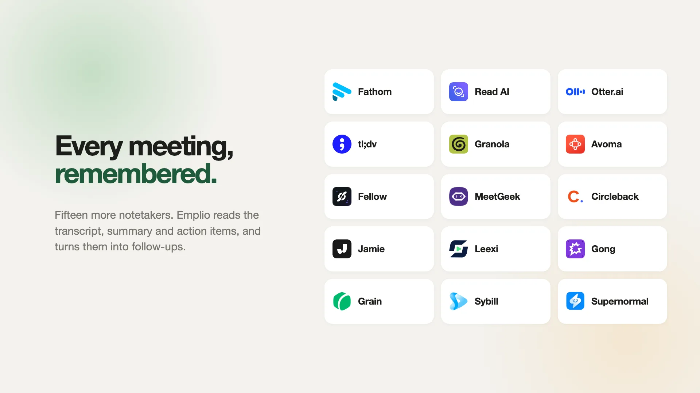

### For developers

- New `own/` apps for the fifteen notetakers, each with COVERAGE notes and tests. Read AI signs in (OAuth); the rest take a pasted key (Fellow `<subdomain>:<key>`, MeetGeek `<region>:<key>`, Leexi and Gong `<id>:<secret>`).
- New-recording triggers: webhooks where the app has them (Fathom, Granola, Avoma, Fellow, MeetGeek, Grain), polls elsewhere (`polls/<app>.ts`).

## 1.4.8 (2026-11-24)

### What's new

- Connect your Plaud or NeoSapien recorder: sign in once, and Emplio can find a recorded conversation, read its transcript and notes, and turn them into follow-ups. 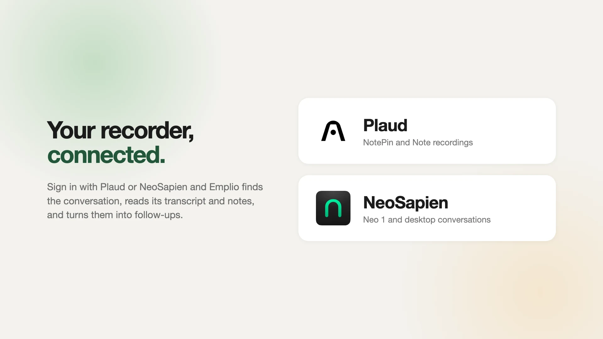

### For developers

- `own/mcp-app.ts`: apps whose maker offers only a hosted MCP server with its own sign-in. They connect like our other OAuth apps (Connect card, connection, refresh), but sign themselves up with the server (dynamic client registration, PKCE, no client id to configure, so self-hosting works), keep the client id with the refresh token, and list the server's tools live as actions (read-only ones run unasked). `OwnApp.oauth.authorizeUrl` may now be async.
- Plaud (`https://mcp.plaud.ai/mcp`) and NeoSapien (`https://api.neosapien.ai/mcp`), with COVERAGE notes; neither has a public API for customer accounts.

## 1.4.7 (2026-11-24)

### What's new

- Connecting Google Meet now asks only to manage the meetings Emplio sets up, not to read all of your past meetings. Emplio can still look up the calls, people and transcripts of meetings it set up.

### For developers

- `google-login.ts`: Google Meet no longer requests `meetings.space.readonly`, which was left out of Google's sensitive-scope review; the requested scopes must match the reviewed ones. Conference records, participants and transcripts still work for spaces the app created (`meetings.space.created`). Privacy page wording matches (cloud).

## 1.4.6 (2026-11-24)

### What's new

- An agent's checklist now fills in as it works, instead of all at once at the end, so you can follow along.
- When an agent finishes but forgot to tick a step, its report reaches you straight away, and it tidies its checklist afterwards; you only hear again if a step really wasn't done.
- Emplio starts a second job for the same agent only when the first is still working, not on every hand-off.

### For developers

- `jobs.ts` `RULES`: give every command the `step` it works on; `AGENTS_HEADING`: `--new` only for the same agent's second job at once.
- `stuck.ts` `progressGuard` takes the checklist and names the open step and its `emplio plan done <n>` in the 10-command reminder.
- `checks.ts`: unticked steps after a Done report no longer send the job back before its report; `openSteps` follows the report with the tool-saving nudge, and a new report from that run replaces the old one.
- New `checklist` eval (ticks as it goes: 0% → 78% on Haiku).

## 1.4.5 (2026-11-24)

### What's new

- Every reply from Emplio now has a Report flag. Tap it, pick what's wrong (offensive, harmful, sexual, wrong or something else), add a note if you like, and it goes straight to the Emplio team to review.

### For developers

- `POST /messages/:id/report` (`chat.ts`): checks the reply is the person's, logs it, and emails `REPORTS_EMAIL` (new, optional) through Resend with the reply's text; 502 if the email fails so the person can try again. `report-reply.tsx`: flag under each reply next to Copy, a dialog with reasons and a note. Google Play requires in-app reporting for AI-generated content.
- Android app 1.0.1 (versionCode 2) for the Play resubmission.

## 1.4.4 (2026-11-23)

### What's new

- Long jobs stay on track. An agent keeps a job card with its task word for word and everything added to it since, plus a checklist you can watch fill in, so it no longer forgets what it was asked halfway through or takes your latest note for the whole job. Sending it more while it works adds to its job instead of replacing it.
- Agents work quietly and finish with one clear report in a fixed shape: whether it's done, what it did, how it checked, files, what changed outside, what's left. If an agent says it's done while checklist steps are still open or its last step failed, it's sent back to finish or explain.
- Emplio checks the proof in every report before telling you something is done, and sends back work that only says "all good".
- Emplio splits big work into parts that run at the same time, one job per site or client, and puts their reports together.
- Once an agent's job is finished, new work starts a fresh job; fixes and retries of the same work still go back to it.
- Long jobs cost less and lose less: an agent is told to save what it found to a file before its chat is summed up, the summary keeps what's done, the facts found and the next step, and summaries reuse what was already sent so they cost less.
- A job's run gets 250 steps, and agents are reminded to keep their checklist up to date when it stops moving.
- Emplio only puts a file in the chat when it's what you asked for or you ask to see it; an agent's working files stay out of the way.
- Emplio answers "has someone replied" or "did the payment come in" by having an agent look, never from memory.
- New agents are named for a role, not a single task, and money, tax, legal and compliance work goes to the stronger model.
- The sign-in box accepts a phone number as well as an email.

### For developers

- `jobs.ts`: `jobCard` (the latest work word for word, additions marked by `carryOn` while busy, the job chat's checklist) after the job's rules, read again after each fold. `RULES`: work silently, checklist for multi-step work, "Getting it right" block, reports in English in `REPORT_SHAPE`. `JOB_MAX_STEPS` 250 per run, then `CARRY_ON`; `stuck.ts progressGuard` reminds every 10 counted commands the checklist doesn't move.
- `checks.ts` (new, no model calls): after a job's run, bad endings (empty, only thinking, cut off, code pasted, "next I'll"), report shape and `doneProblem` (open checklist steps, failed last command) send it back, at most `MAX_PUSHES` (3) per piece of work.
- `emplio hand <agent>` adds to the agent's job only while it works or asks; a finished job carries on only by id. `MANAGER_PROMPT`: split independent parts into jobs side by side (worked example), check each report's proof, a send-back goes once.
- `compact.ts`: `forkNotes` takes notes on the chat's own request (same system, tool definitions, messages) so the cache is read, on the summary model (Haiku); transcript notes as fallback. `JOB_SYSTEM` notes template for jobs. `SAVE_FIRST`: a job past 80% of `compactAt` is told once to save to a file before it's folded. `trimSteps` cuts old outputs inside a run.
- `sandbox.ts`: `web answer` / `web read` described; files shown only when asked for or the deliverable. `SILENT` moved to `@emplio/shared` (an import cycle left it unset in jobs.ts).
- Evals: `bun run evals` runs every eval in parallel (~2 min), on this machine by default (`EVAL_SEND=1` sends to Braintrust); new `job-report` eval; Haiku 90%+ across them. PR 362, PR 365.

## 1.4.3 (2026-11-23)

### What's new

- Emplio can tag people in your WhatsApp groups. Ask it to mention someone and they get a real @ tag and a notification, not just their name in the text.

### For developers

- `whatsapp_linked.send_message` takes `mention` (phone numbers, up to 50). The worker's `/send` lists them in `ContextInfo.MentionedJID` and makes sure the text has `@<number>` for each (added at the start if missing). In groups that hide numbers (`AddressingModeLID`) the tag uses the person's hidden id. `Mentions` in `text.go`, tested in `TestMentions`.
- Going live needs the Go worker redeployed on the WhatsApp box.

## 1.4.2 (2026-11-23)

### What's new

- Commands run faster: the checks around each step take one trip to Emplio's computer instead of three or four, about 0.3 seconds less per step.
- See how long work takes: a group of steps shows its total time ("Ran 3 actions · 14s"), and an agent's card counts up while it works and keeps its time once done.

### For developers

- `sandbox.ts`: the out/ listing and a member's file check are printed at the end of the command itself (`afterTrailer`, `splitAfter`); asked for separately only when the command didn't reach its end. The keep-awake call runs alongside a command when the computer answered one in the last minute. Timezone and GitHub address are looked up once per reply.
- Command outputs carry `ms` (kept from the model in `toModelOutput`); `JobInfo.ms` is a run's time so far, or in all once finished.
- `jobs.ts`: a restart's or the step limit's "carry on" no longer ends a run's card (`runSpan`); an earlier run's end is the tool-saving nudge's time, or its last reply's start plus its steps (`runEnd`).

## 1.4.1 (2026-11-22)

### What's new

- Fifteen more apps for client businesses, each connected by pasting a key: Klaviyo and ActiveCampaign for email marketing; Close, Apollo.io and lemlist for sales and outreach; Wrike, Teamwork.com and Smartsheet for projects; Karbon for accounting and bookkeeping firms; Everhour for time tracking; Cal.com for bookings; Typeform for forms; Figma for design; Webflow for websites; and Chargebee for subscriptions. Emplio can follow up with leads, run campaigns and outreach, move client work along, log hours, book meetings and keep sites up to date, and start work by itself when a form is filled in, a client comments on a design, a meeting is booked or a payment fails. 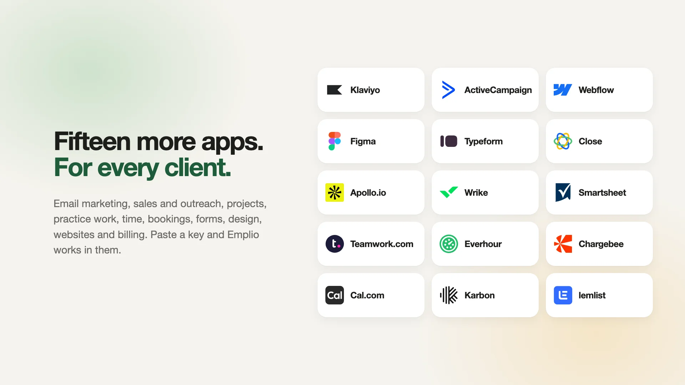

### For developers

- New own apps under `backend/src/integrations/own/`: `klaviyo`, `activecampaign`, `close`, `apollo`, `lemlist`, `wrike`, `teamwork`, `smartsheet`, `karbon`, `everhour`, `calcom`, `typeform`, `figma`, `webflow`, `chargebee`. Key sign-in only; each has `COVERAGE.md`, tests, and webhook triggers where the app allows them by API, polled ones otherwise.
- Karbon needs Emplio's application key from Karbon's developer program in `KARBON_APP_KEY`; each firm pastes its own Access Key.
- `automations.ts`: an event on the shared app webhook route that names no automation id also matches automations saved under `<app>:<connection>`. Zendesk (and any app whose webhook address carries only a token) didn't start its automations before.
- `own/openapi.ts`: error messages also read `errorDescription` (Wrike).

## 1.4.0 (2026-11-22)

### What's new

- Fifteen new apps for agencies and other client businesses, each connected by pasting a key: Harvest, Toggl Track and Clockify for time tracking; Jira, Linear, monday.com, Trello and Productive for projects; HighLevel and Pipedrive for clients and deals; Zendesk and Freshdesk for support; PandaDoc and Dropbox Sign for proposals and signatures; and Shiprocket for shipping. Emplio can log hours, move work along, update deals, answer tickets, send contracts for signature and book shipments, and start work by itself when something happens, like a deal moving stage, a ticket coming in or a contract being signed. 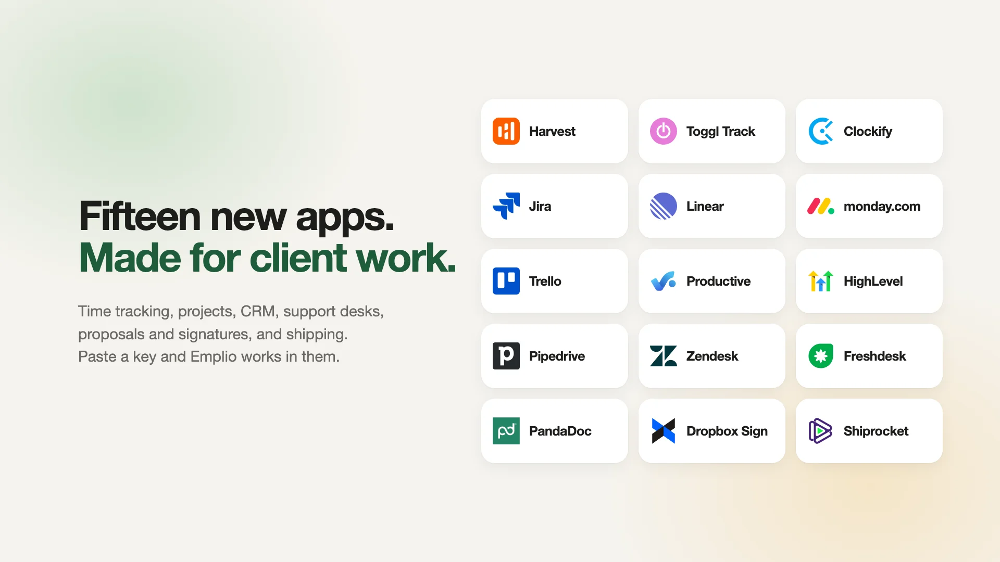

### For developers

- New own apps under `backend/src/integrations/own/`: `harvest`, `toggl`, `clockify`, `jira`, `linear`, `monday`, `trello`, `productive`, `gohighlevel`, `pipedrive`, `zendesk`, `freshdesk`, `pandadoc`, `dropbox_sign`, `shiprocket`. Key sign-in only; each has `COVERAGE.md`, tests, and webhook triggers where the app allows them by API, polled ones (`polls/<app>.ts`) otherwise.
- `automations.ts`: the app webhook route also takes `multipart/form-data` (Dropbox Sign callbacks), kept raw.
- `own/openapi.ts`: error messages read `error.error_msg` and `description`, and list field errors given as an array or under `details`.
- `composio-names.ts` and the skill's `coverage.ts` skip the empty `"tools":[]` Composio's toolkit pages now start with.
- `new-integration` skill: every app also gets its website page (`cloud/frontend/seo/apps.ts`), docs row and changelog picture.

## 1.3.9 (2026-11-22)

### What's new

- When Emplio's server restarts (after an update), an agent that was working picks up where it stopped by itself, once, instead of getting a second "carry on" from the main chat. This now works for agents given new work hours after they began too.

### For developers

- `resume.ts` leaves job chats to `markOrphanedJobs` (`jobs.ts`), so a cut-off job is carried on once, through its job path. `markOrphanedJobs` times a job from the last message asked of it, not from when the job was created (#349).

## 1.3.8 (2026-11-22)

### What's new

- Emplio can list every WhatsApp group you're in at once, or only the ones a given person is in, and see where you're an admin, instead of checking groups one by one.
- Your linked WhatsApp is protected from asking WhatsApp too much: lookups are capped at 30 a minute and 300 an hour, group changes at 30 an hour and 100 a day, and if WhatsApp ever says "too many", Emplio stops reaching it for 15 minutes and tells you, while your saved chats stay readable.
- Messages you send with bold, lists, headings or code now show formatted instead of with raw asterisks.

### For developers

- `whatsapp/limits.go`: per-account pacing by route (`r.Pattern`): live lookups 30/min and 300/hour, group changes 30/hour and 100/day, a 15-minute pause on "rate-overlimit" that also stops sends; local reads are never counted.
- Group details are kept for 10 minutes (`groupInfo`, `joinedGroups`); any group change drops them.
- New `GET /accounts/{id}/groups?with=` and `whatsapp_linked.list_groups`. Group adds and new groups no longer count as sends; they count as group changes.
- Takes effect once the WhatsApp worker is redeployed.
- `chat-view.tsx`: sent messages with markdown render through the markdown view; plain ones keep @mention and /command highlights (#347).

## 1.3.7 (2026-11-21)

### What's new

- A cleaner message box: one line inside a chat, a few lines on a new chat, with the mic and a filled send button inside it.
- Buttons under the box for attaching, commands (/) and mentioning (@), so you don't need to know what to type. On a phone they sit behind a + in the box, and the keyboard closes once you send.
- Attach a folder from the same attach button, or drag a folder into the chat. It's sent as one zip with its sub-folders kept.
- Late at night or early in the morning, the greeting changes: "Working late?", "Still up?", "Up early?".
- A step's name that's too long for its row can now be read in full: hover over it, or open the step (tap it on a phone).
- When a job asks for your OK on many things at once, the first card shows in full with "N more waiting after this" under it; answering it brings up the next.

### For developers

- `chat-view.tsx` composer: single-row input with mic and send inline, tool row under it on fine pointers, a + menu on coarse pointers; / and @ buttons put the character in and open the same menus (`useMentionMenu` returns `moveCaret`) (#344, #345, #346).
- `zip-folder.ts`: `zipFolder` takes `{file, path}` pairs; `readDropped` walks a dropped folder entry (#344).
- `tool-calls.tsx`: cut-off step labels get a `title` and wrap when the row is open (#334); waiting Allow cards show one at a time (#340).

## 1.3.6 (2026-11-21)

### What's new

- When Emplio fills a saved login into a website, it now presses Enter afterwards, so most sign-in pages go straight through without a separate click.

### For developers

- `backend/src/logins.ts` `fill` sends Enter (`Input.dispatchKeyEvent`) to the box typed last, except when a single `field` was named. Its reply and the agent instructions in `sandbox.ts` say to press the button only if the page hasn't moved on (#332).

## 1.3.5 (2026-11-21)

### What's new

- When a site isn't signed in and no login is saved, Emplio asks you to save the login first instead of asking how you want to sign in. Once saved, it signs in by itself next time. Signing in yourself in the browser is still there if you'd rather not save it.

### For developers

- Agent instructions (`sandbox.ts`, `jobs.ts`): with nothing saved, `emplio logins ask` comes first; browser sign-in only if the person declines or the site has only "Continue with Google" (#331).
- `emplio logins fill` with nothing saved now points to `emplio logins ask`.

## 1.3.4 (2026-11-21)

### What's new

- New here? Each part of Emplio now shows a short tip the first time you open it: your chat, Work, a task, Memory, Team, your menu, Integrations, the first job an agent takes on, the first file Emplio makes for you, sharing a file, and the first time Emplio asks for your OK. Step through with Back and Next; see them all again from your menu, under Product tour.
- On the phone app, Emplio asks to send you notifications after your first message, not as soon as you sign in.
- The menu's "Help guides" is now just "Help".

### For developers

- `frontend/src/components/tour.tsx` replaces `tips.tsx`: a list of short tours (`TOURS`), each with a `when()` and steps that point at `data-tip="<id>"` elements. A tour starts the first time its part is on screen, skips steps whose target isn't there, dims the rest of the page lightly and leaves it usable. Seen tours are kept per device in localStorage (`emplio-tours`); only people who came through the welcome dialog get them. To add one: mark the element with `data-tip` and add an entry to `TOURS`.
- Push permission is checked (not requested) at sign-in; `first-run.tsx` `Offers` asks after the first message.

## 1.3.3 (2026-11-21)

### What's new

- Long WhatsApp messages that were quoted before 1.3.2 now reach Emplio in full too, not cut after 300 characters.
- Emplio knows it can fetch older WhatsApp messages from your phone when a chat has little saved.

### For developers

- `whatsapp/account.go` `fullQuote`: quotes saved cut ("…") are read again from the saved raw message. Takes effect once the WhatsApp worker is redeployed.
- `whatsapp_linked` `list_chats`, `get_messages` and `search_messages` point to `load_older_messages`.
- Next.js 16.4.2 → 16.4.6 (#336).

## 1.3.2 (2026-11-21)

### What's new

- When a reply fails, the message says why when it's a common reason (the model is busy, the chat got too long, the model isn't available) instead of only "Something went wrong".
- Replying in your main chat now closes the Allow cards an agent showed there, the same as replying in the agent's own chat.
- Voice input types into the box your cursor is in, so it works in a reply box too.
- Notification popups show at most 4 lines.
- Files up to 100 MB can go to and come from your apps (Google Drive uploads, Gmail attachments), up from 25 MB.
- Emplio's thinking shows headings, bold text and lists properly.
- Tables in replies look cleaner, and long ones show in full instead of in a small scrolling box.
- Attach a whole folder on a computer: it goes as one zip, with its sub-folders kept.
- A zip too big to import now says so, instead of "Nothing in what you picked".
- A long WhatsApp message someone replies to reaches Emplio in full, not cut after 300 characters.
- Background rounds run every 4 hours by default instead of every 2.

### For developers

- `approvals.ts` `moveOn` also skips cards shown in the chat (`showIn`), not only cards asked there (#325).
- `chat.ts` `replyError` maps common provider failures (429, 402, 401/403, 404 and "banned" models, context length, 5xx and timeouts) to plain messages; the chat's error card shows them (#321, #314).
- `voice-input.tsx` writes into a focused reply note (`data-quote-note`) (#323); the in-app toast title is clamped to 4 lines (#320).
- App file limit 25 → 100 MB in `integrations/index.ts` and `composio.ts` (#315).
- Thinking text renders with `MessageResponse` (#312); Streamdown tables restyled in `globals.css`, 300px height cap removed (#313).
- `lib/zip-folder.ts`: picked folders become one stored zip (#309); the import page reports ZIP64 zips as too big (#322).
- `whatsapp/text.go` `QuotedOf` keeps up to 4000 characters (#327). Takes effect once the WhatsApp worker is redeployed.
- Background rounds default to every 4 hours (#308).

## 1.3.1 (2026-11-20)

### What's new

- Emplio can do everything WhatsApp lets a linked device do. Reply privately to someone's group message in their own chat, send locations and contact cards, vote in polls, star messages, and fetch older messages from your phone. It can mute, archive, pin, mark unread and delete chats, turn on disappearing messages, and use your WhatsApp Business labels. In groups it can change the photo, approve or turn down join requests, check an invite link before joining, and run communities. It can look up anyone's profile (with a business's address and hours), block and unblock people, change your privacy settings, about text, name and photo, share your contact link, post a status, and follow, read and post in channels.
- WhatsApp replies go faster: Emplio can answer people who wrote in the last day up to 60 times an hour (300 a day). Messages to chats that have been quiet stay at 20 an hour, so your number stays safe.

### For developers

- `whatsapp/more.go`: the rest of whatsmeow's client, as HTTP routes (`reply-private`, `location`, `contact-card`, `vote`, `star`, `history`, `chat/{mute,archive,pin,unread,delete,disappearing,label}`, `labels`, `label`, `message/label`, `group/{photo,requests,preview}`, `communities`, `community/{groups,link}`, `profile`, `blocked`, `block`, `privacy`, `me`, `contact-link`, `status`, `channels`, `channel`, `channel/{messages,follow,mute,react,post}`). Chat-list changes go through app-state patches; labels are kept in the account's kv from `LabelEdit`/`LabelAssociationChat` events (one full regular-patch fetch for older accounts); on-demand history leaves unread counts alone; `Store.Oldest` and `Store.DeleteChat`; group and profile photos become square JPEGs (stdlib). `create_group` takes a community, `update_group_settings` adds `only_admins_add` and `join_approval`, `send_file` sends .webp as a sticker.
- Send limits: replies (the other side wrote in the chat in the last 24 h) get 60/hour and 300/day counting every send; other sends stay at 20/hour and 150/day counting only non-replies (`sends.reply`, `Store.HeardFrom`).
- `whatsapp_linked`: 44 new actions (74 in all); COVERAGE.md lists them and what's still left out (calls, presence, others' statuses).

## 1.3.0 (2026-11-20)

### What's new

- WhatsApp is here. Link your own WhatsApp or WhatsApp Business: connect **WhatsApp** in Integrations and scan the code from your phone (WhatsApp → Linked devices), like WhatsApp Web. Emplio can then read and search your chats and groups, reply to messages, send files and polls, forward, edit, delete and pin messages, run your groups (make them, add and remove people, admins, settings, invite links), check which numbers have WhatsApp, and run automations on new messages, edits, deletes, reactions, poll votes, people joining or leaving groups and new chats. WhatsApp automations come with paid plans: checked every hour on Starter and Growth, and the moment it happens on Pro. It only writes to people and groups you already chat with, and keeps it slow so your number stays safe. 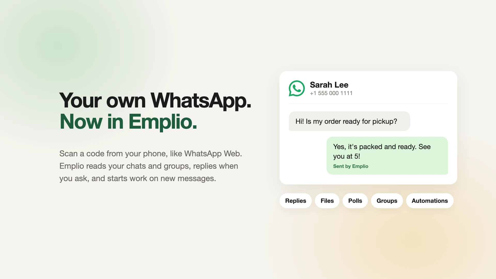
- The official WhatsApp Business API connection is now called "WhatsApp Business API".

### For developers

- New `whatsapp/` service in Go with whatsmeow (pure-Go SQLite: the login in `whatsmeow.db`, chats and messages with FTS5 in `data.db`, one folder per account) behind a token-protected HTTP API. Nobody stays connected: accounts connect when used, drop after 10 idle minutes, and catch up every 4 hours. Sends: known chats only, 20/hour and 150/day. About 29 MB with an account linking (Baileys was about 126 MB idle).
- `whatsapp_linked` own app: 30 actions (Periskope's WhatsApp-level API as the checklist; a separate `reply_to_message` because small models miss `send_message`'s `reply_to`), linking through the OAuth plumbing with our own QR page (`/whatsapp/link`), and a polled `new_message` trigger (`polls/whatsapp_linked.ts`, every 60 minutes, at least 60) over the new `list_recent_messages` action, plus 7 event triggers (edits, deletes, reactions, poll votes, group members, new chats, added to a group) over `list_events`. The server records those events, delivery ticks, reactions and poll votes (`events`, `reactions`, `votes` tables). Plans: new `OwnApp.plans` ({ triggers, instant }) checked by `triggerPlan` in `startTrigger` (refused with an upgrade message, polled, or pushed), `cloud.plan(workspaceId)` (null where nothing is sold: everything allowed), and an hourly `recheckPlans` that sets automations up again when a plan changes. Only `whatsapp_linked` sets it: Pro gets push through a watch on the WhatsApp server (`PUT /accounts/{id}/watch`: the account stays connected and posts each message and event, HMAC-signed, to `/webhooks/app/whatsapp_linked/<connection>`). Needs `WHATSAPP_URL` and `WHATSAPP_TOKEN`; Docker installs get a `whatsapp` service and the token from setup.sh.

## 1.2.102 (2026-11-20)

### What's new

- Automations can use the steps Emplio saved for reuse. The ones that already exist are allowed once, on the same card as the automation's other actions; ones made later just run.
- An automation run that hit a problem no longer passes as "nothing to do": it shows as failed and you're told, so Emplio's check-in can fix it.
- Big Gmail searches come back in full instead of failing as too large.
- After a job's report, its chat shows a "Saving steps to reuse next time" line instead of "Nothing to keep."
- Agents keep seeing every step they can reuse after Emplio's daily tidy-up moves some to another file.
- Listing your GitHub repositories works again, and a few confusing error messages are clearer.
- On a Mac running several chats at once, Emplio's helper files can no longer be read half-written.

### For developers

- `sandbox.ts`: kernel.py, the emplio library and the emplio binary are uploaded under a per-reply suffix and moved into place in the install command (#295).
- GitHub `list_repositories_for_the_authenticated_user` never sends `type` with `visibility`/`affiliation` (422); `emplio threads show` with no ref shows the latest job; store-skill errors with no message say what failed (#296).
- `composio.ts` `fetchInPages`: `gmail.fetch_emails` past Composio's payload limit is re-asked in halving pages by `page_token` and joined; an email too big alone comes without its payload, with a `note` (#298).
- Automations list saved tools (`tools.<area>.<name>`, risk changes/spends) named in the prompt or on the agent's list as actions; `approve` lets an automation's run use a saved tool it doesn't list (`listedActions`) (#299).
- `toolDefined` (agents.ts) follows `from tools.<area> import` re-exports (3 hops, aliases) for agents' tool lists and `addTools` (#300).
- `outcome`: a run with a problem reported in its chat or its jobs' chats that ends [SILENT] fails (#301).
- `KEEP_TOOLS_PREFIX` / `keptNothing` (shared): the tool-saving nudge renders as a divider and its "Nothing to keep." reply is hidden (#302).

## 1.2.101 (2026-11-20)

### What's new

- Emplio plays a short chime when a reply or a job finishes while you're in another tab or app, so you know without checking. Turn it off in Settings, under Notifications.

### For developers

- `useDoneSound` (frontend/src/lib/done-sound.ts), used in the sidebar for the chat list and the jobs list: chimes when a chat stops `running` or a job leaves `working` while the page is hidden or unfocused (the same test `useLiveEvents` tells the server). Plays `public/sounds/done.mp3` ("New Notification 010" by Universfield, Pixabay license); at most one every 2 seconds; web only (not the Mac or phone app). The on/off choice is kept in localStorage (`emplio-done-sound`).

## 1.2.100 (2026-11-19)

### What's new

- Emplio gets website work done in fewer steps: it does what it already knows in one go (signing in and moving on, filling and saving a whole form), goes straight to a record's own page, and makes the same change to many records in one pass. In our tests a website task cost about 17% less, and the same change on 8 orders about 27% less.

### For developers

- `browserGuide` (sandbox.ts): rules 2 to 5 on steps: everything already known in one run or command, a loop by `find` for the same change on several records, a record's own address over searching or paging (`snapshot -i -u`), and looking for what's needed (`snapshot -i | grep`) after a first look. Main's 1.2.99 guide changes kept as they are.
- Browser benchmark: new `bulk` task (8 orders to Delivered); `/work` in commands maps to the run's folder; each run gets its own agent-browser socket folder (runs side by side once shared a browser); the first browser result gets the command list, as `firstInChat` gives it. Main vs this, 6 tasks × 4 runs on Haiku: 23/24 → 24/24, 11.8 → 9.5 steps, $0.0041 → $0.0034 a task.

## 1.2.99 (2026-11-19)

### What's new

- Emplio reads much shorter instructions before each reply, so replies cost less and it gets commands right the first time more often: it rarely has to look up how a command works.
- It does independent things at the same time (several look-ups in one go) instead of one after another.

### For developers

- Code mode: the system prompt carries a Python signature list of the `emplio` library (`commandList` in `sandbox.ts`, one for Emplio and one for agents), replacing per-command sentences; a test checks every listed command and flag exists. `agentRules`, `MANAGER_PROMPT` and the sandbox instructions compressed: the manager prompt is about 8,900 → 7,200 tokens. In a 36-reply probe, `help()` calls went 16 → 6 and wrong flags 1 → 0; hand-off, manager, skills, background-round and workday evals hold (workday input per chat 136k → 115k).
- New rule in `agentRules`: commands that don't need each other's results go in the same step (they already run side by side, up to 4).
- Browser: every command as a Python list (`BROWSER_COMMANDS`), sent with the first browser result once per chat (again after the chat is folded into notes, `Session.notesUpto`); `emplio browser help` prints it without starting a browser. Without code mode, the first result and `help` carry `BROWSER_SKILL` instead.

## 1.2.98 (2026-11-19)

### What's new

- Agents learn from every piece of work you give them, not only the first. When you send more work to an agent that's already done a job, it now also keeps what it worked out as tools, so the next time is quicker.

### For developers

- The tool-saving nudge (`SAVE_TOOL`) now goes after each finished run of a job, not once per job. `nudged()` skips the nudge's own run (also when a restart or the step limit splits it) and runs with 2 commands or fewer (`SMALL_WORK`). The other conditions stay: completed, not interrupted, not asking, done, and no tool saved in that run.

## 1.2.97 (2026-11-19)

### What's new

- Emplio spends less when it works on websites for you: it now starts from a much shorter guide to the browser, so a typical website task costs about 12% less, with the same results.

### For developers

- `emplio browser skill` prints our own guide (`BROWSER_SKILL` in `sandbox.ts`, about 1.8 KB) instead of agent-browser's core skill (14 KB), which was mostly sessions, installing and add-ons the wrapper already handles. `emplio browser skill --ref <topic>` still reads agent-browser's references.
- New benchmark `backend/evals/browser/bench.ts`: an agent job's own instructions, the real `emplio` wrapper and agent-browser, a local Chrome and a made-up shop admin (`site.ts`), marked by what the site says happened. `BENCH_SRC` points it at another checkout to compare two versions. On 5 tasks × 4 runs (Haiku): 20/20 both, $0.0049 → $0.0043 a task, page text read −30%. A trial of snapshot `--delta` after every click cost 5–20% more (the agent still lists the page) and was dropped.

## 1.2.96 (2026-11-19)

### What's new

- Emplio is coming to Android phones. The app works like the iPhone one, with notifications you can reply to straight from the notification.
- A new page, emplio.app/delete-account, explains how to delete your account and what happens to your data.

### For developers

- `mobile/android`: Capacitor Android shell (target API 36), edge-to-edge layout, its own Firebase messaging service with an inline Reply action that posts to `/push/reply`. Release signing reads the properties file named in `EMPLIO_ANDROID_SIGNING`; `app/google-services.json` stays out of git.
- `backend/src/push.ts` sends to Android through Firebase Cloud Messaging (HTTP v1) when `FCM_SERVICE_ACCOUNT` is set; Apple tokens are told apart by their hex shape.

## 1.2.95 (2026-11-19)

### What's new

- In the iPhone app, the bar with arrows and a Done button no longer sits above the keyboard. To put the keyboard away, tap outside the box or drag the chat.

### For developers

- `(app)/layout.tsx` calls the Keyboard plugin's `setAccessoryBarVisible({ isVisible: false })` once (#282); no app store update needed. The chat's message list blurs the focused field on touch move, since the bar's Done was iOS's only button to close the keyboard. Mobile Safari still shows the bar.

## 1.2.94 (2026-11-19)

### What's new

- When a button on a website has no name Emplio can read, like an icon, a map or a drawing area, Emplio now looks at the page and clicks the right spot instead of getting stuck.

### For developers

- Browser instructions in `sandbox.ts` drop "Never click by position". When no ref works the agent takes `emplio browser screenshot --annotate` (its labels are refs), then falls back to `mouse move <x> <y>` with `mouse down/up left` and looks again.

## 1.2.93 (2026-11-19)

### What's new

- Four more Zoho apps: Zoho Inventory, Zoho Billing, Zoho Campaigns and Zoho Desk. Sign in with your Zoho account and Emplio can keep an eye on stock and orders, look after subscriptions and failed payments, grow your mailing lists and send campaigns, and answer and sort support tickets. Each can start work by itself too, like when stock runs low, a payment fails or a new ticket comes in. 

### For developers

- New own apps `zoho_inventory`, `zoho_billing`, `zoho_campaigns`, `zoho_desk` (#262, #263, #264, #265) on the shared Zoho client (`zohoOAuth`), each with `COVERAGE.md`. Inventory and Billing are generated from Zoho's spec zips (`zohoZip` now takes `inventory` and `billing`), Desk from github.com/zoho/zohodesk-oas (`orgId` sent as a header and auto-filled), Campaigns by hand (v1.1, host worked out from the Mail host per data centre). `zoho-login.ts` gains an optional `desk` host per data centre and `zohoDesk()`.
- Triggers: Desk registers its own webhooks (56 events, one per connection and organisation, token in the path since Desk doesn't sign); Inventory, Billing and Campaigns are polled (Billing reads its event log).
- Scopes checked on Zoho's consent page for all four; the four callbacks are added to the Emplio client in Zoho's console.

## 1.2.92 (2026-11-19)

### What's new

- Choosing who does a task on the Work page now has a search box, with Emplio first and then your agents and your team under their own headings, so you can find one agent among dozens instead of scrolling a long list.

### For developers

- `WhoSelect` in `tasks-page.tsx` is the Combobox popup (button trigger, search inside, `ComboboxGroup` per kind) instead of a `Select`; values are unchanged (`ai`, `agent:<slug>`, user id), and agent labels lose the "(agent)" suffix (#281).

## 1.2.91 (2026-11-19)

### What's new

- Seven more apps connect with a key you paste, no sign-in pages: Shopify, Mailchimp, Brevo, Cashfree, PayU, and your own PostgreSQL or MySQL database. Emplio can look after orders, stock and refunds in your Shopify store, grow your mailing lists and send campaigns, check payments and send payment links, and look things up or run reports straight from your database. Each one can also start work by itself, like the moment an order comes in, a payment fails or someone unsubscribes. 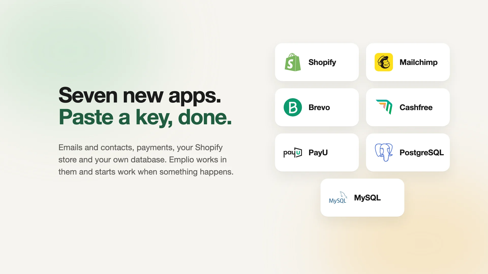

### For developers

- New own apps `shopify`, `mailchimp`, `brevo`, `cashfree`, `payu`, `postgresql`, `mysql` (#254, #258, #260, #261, #266, #267, #268), each with `COVERAGE.md`. Brevo, Mailchimp and Cashfree are generated from their OpenAPI specs (`scripts/openapi/<app>.ts`); Shopify from its Admin GraphQL schema (`own/shopify/generate.ts`, API 2026-10, `graphql` and `graphql_query` on top); PayU by hand. Shopify takes `store shpat_…` or `store client_id secret` (client credentials, 24-hour token cached in memory). Cashfree and PayU take `ID:SECRET[:sandbox|test]`.
- Webhook triggers for all five API apps through `/webhooks/app/`; apps that don't sign deliveries carry an HMAC-of-`ENCRYPTION_KEY` token in the path. Cashfree and PayU webhooks are set in their dashboards (`get_webhook_setup` gives the address). The shared route now takes form-encoded bodies and answers a GET for apps with `receive` (Mailchimp checks the address first).
- `own/sql`: one read-only transaction per lookup, 1000-row cap, 30 s timeout, a connection per call. Every connect resolves the host, refuses private and internal addresses and our own database (`isPrivate`), then connects to the checked address with TLS verified against the host name. Polled triggers `new_row`, `row_updated`, `query_result_changed`.
- `own/openapi.ts` reads `detail` from error bodies (Mailchimp).

## 1.2.90 (2026-11-19)

### What's new

- Every new agent Emplio makes now comes with written instructions on how to do its work, taken from the job it learned from, and agents made without any get them after their next finished job.

### For developers

- `emplio agents add` refuses without instructions (the heredoc body) and says what to write.
- `agentNudge` asks Emplio to write instructions (`emplio agents update <slug> -`) under the report of a finished job whose agent has none.

## 1.2.89 (2026-11-19)

### What's new

- An app that now connects a different way says so in Integrations, instead of only showing as expired.
- The page for pasting an app's key no longer turns into an error page when something goes wrong on our side; it shows the form again with a message. Opening it without the link from your chat says to use that link, instead of saying the link expired.
- Messages about an account that needs signing in again say why in plain words, and asking to sign in to an app that takes a key says to paste the key instead.

### For developers

- `toConnection` gives a connection on an app's old provider a `problem` (`MOVED`); `runAction` and `startTrigger` say "needs signing in again: it now connects a different way" instead of naming `emplio apps reconnect` (the `appsCommand` hint still gives the agent the command), and `runAction` no longer shows the raw status. The key form's `POST /connect/:app` and `/oauth/:app/callback` log errors other than `AppsError` and show `SOMETHING_WRONG` instead of rethrowing (500); a POST with no `t` gets its own message. `connect()` on a key-only app names the key field (#221).

## 1.2.88 (2026-11-19)

### What's new

- An automation that couldn't do its work, like one stopped by a sign-in check every time, now shows as failed with the reason, and the reason comes to your chat, instead of showing as done.
- An automation that hands its work to an agent now shows as running until the agent has finished, and you get the agent's real result rather than "still working".

### For developers

- A run's last words decide its status (`outcome` in `automations.ts`): a line with `[NOT DONE]` (`NOT_DONE`, which the run's first message, now `runMessage`, asks for when the work was blocked or little of it went through) or no words at all make it `failed`, with the line as its `error`; only an error used to. A run whose reply ends with hand-offs still working, or reports it hasn't read (`reportsDue` in `jobs.ts`), stays `running` and ends with the reply those reports wake (`woke`, called from `wake`), or after `JOB_MINUTES` + 15 if they never come. A job whose reply ends with no words is `failed` ("(it ended without a report)"), not `done`. New eval `evals/automation-outcome` (97% right on 12 cases × 3) (#244).

## 1.2.87 (2026-11-19)

### What's new

- Notifications on your phone, Mac and browser now show much more of a long reply instead of stopping after a sentence or two.

### For developers

- `plain()` in `backend/src/push.ts` cuts at 1000 characters instead of 180, leaving the shortening to the device; the cap stays so the payload fits Apple's and web push's 4 KB limit (#208).

## 1.2.86 (2026-11-19)

### What's new

- Commits Emplio makes in your GitHub repositories now carry your name and your GitHub account, so Vercel and similar services deploy them instead of blocking them for an unknown author.

### For developers

- Commands on Emplio's computer get `GIT_AUTHOR_*`/`GIT_COMMITTER_*` set to the person's name and the noreply address GitHub keeps for their connected account (`<id>+<login>@users.noreply.github.com`, from `GET /user`, cached per login: `githubAddress` and `gitAuthor` in `git-proxy.ts`), instead of the box's `bot@emplio.local`, which no GitHub account has and which Vercel refused with `COMMIT_AUTHOR_REQUIRED`. With no GitHub account connected (or GitHub not answering) it stays `bot@emplio.local`. Saves to company, restricted and me also accept that address from the person's own git (`Pusher.github` in `refused`); it names nobody on the team, so like `BOX_EMAIL` it runs no automation as anyone (#210).

## 1.2.85 (2026-11-19)

### What's new

- Connected apps no longer show "Expired, reconnect" when nothing is wrong. A sign-in you started but didn't finish no longer leaves an expired account behind, and one action an app turns down no longer marks your account expired.
- An account marked expired that still works goes back to connected by itself.
- Reconnecting an account keeps the old sign-in working until the new one is finished, so giving up halfway loses nothing.
- When an account was connected without some permissions (a box left unticked on Google's page), Integrations says so and offers Reconnect, and Emplio tells you which of your accounts to use instead.
- Disconnecting one Google app no longer signs out your other Google apps on the same Google account.

### For developers

- `runAction` marks a connection expired only once the login holder agrees (`loginWorks`: Composio's account status, or our app's `check` with a renewed login); otherwise it reports the action as turned down. Expired connections are re-checked (`recheck`, at most every 5 minutes) and go back to active. `connections.problem` keeps why, shown in the app and `emplio apps list` (#219, #221).
- Unfinished sign-ins: a new account that never signed in is deleted instead of stored as expired; a reconnect keeps its old login in `connections.old_external_id` and goes back to it if the new sign-in isn't finished. Our own apps' sign-ins time out after 15 minutes like Composio's.
- OAuth renewals take a Postgres advisory lock on the connection and re-read it first, so two servers or a stale copy never spend a single-use refresh token twice.
- A missing-permissions answer (`MISSING_SCOPE`) sets `problem` on the connection and names the person's other working accounts.
- Disconnecting one of our Google apps revokes Google's grant only when no other of the person's Google apps is on the same Google account (`sharesGoogleGrant`).
- Migration: `connections.old_external_id`, `connections.problem`.

## 1.2.84 (2026-11-19)

### What's new

- A saved tool that reads text from a web page now gets that text exactly, so an empty answer counts as empty (a sign-in with no error is no longer taken as refused).

### For developers

- `_parse` in `backend/src/python/py/emplio/__init__.py` also decodes a JSON string answer (`"..."`), so `emplio.browser.eval("''")` returns `''` not `'""'`. Checked in `test_toolset.py` (#243).

## 1.2.83 (2026-11-19)

### What's new

- Select text in a file open beside the chat, such as a PDF, a Markdown file or a spreadsheet, and press Reply to answer just that part. On a phone you're taken back to the chat to write your answer. 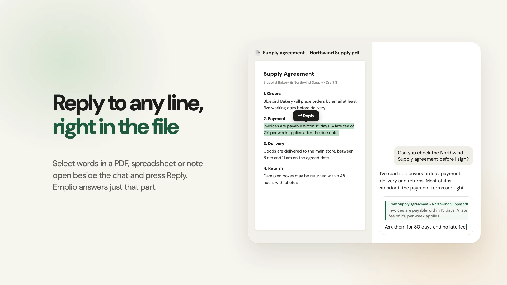
- PDFs now open in Emplio's own viewer on every screen, so their words can be selected and copied.

### For developers

- `QuoteButton` also takes selections inside `[data-quotable]` (the `FilePanel` preview) and tells `onQuote` whether the text came from a file. `PdfFrame` always draws pages with pdf.js, now with its `TextLayer` over each page (styled by `.pdf-words` in `globals.css`), instead of the browser's PDF viewer on desktop, whose text can't be read by the page (#200).
## 1.2.82 (2026-11-19)

### What's new

- A saved tool that uses the browser now works the first time a chat calls it, without the browser having to be opened first.

### For developers

- `emplio browser` with no `BROWSER_CDP_URL` in code mode asks the server for the chat's browser over the live channel (`BROWSER` in `liveRoutes`) at its first browser command, and keeps it in `/tmp/emplio-browser.$EZ_KEY` for the rest of that run; the browser is then shown and its downloads copied after the command as usual. Attaching and the background/showing refusals are shared by the step start and the live request (`attachBrowser`, `browserRefused`) (#242).

## 1.2.81 (2026-11-19)

### What's new

- On the Work page you can now give a task to one of Emplio's agents, like Inbox Triage, the same way you pick a person or Emplio. The agent does it, and its name shows on the task. 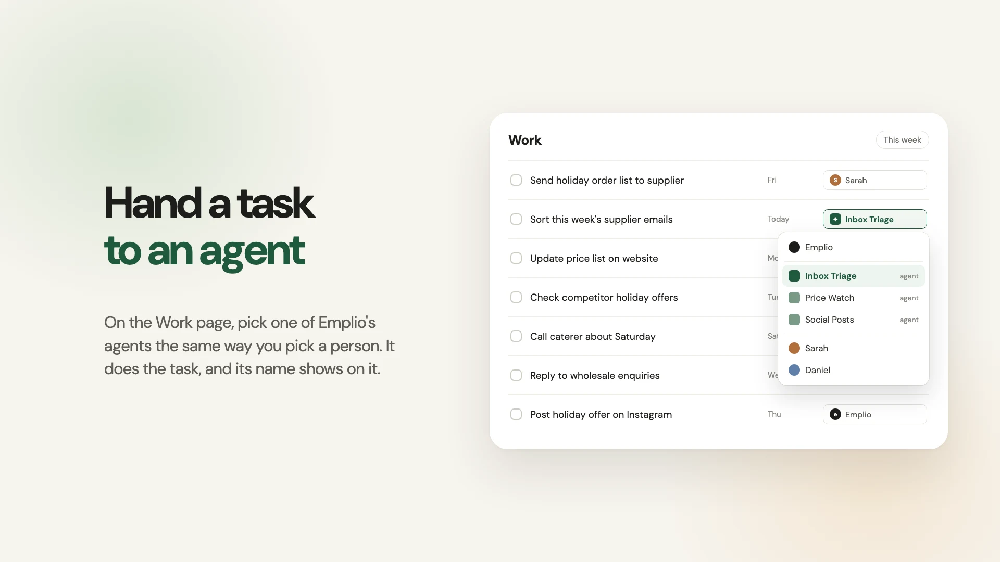

### For developers

- Tasks have an `agent` column (the agent's slug, so a renamed agent stays on its tasks; `Task.agentName` is what it's called now, as whoever asked sees their agents; `assigneeId` stays null, so it's still the AI's own task). Its run starts in the chat it came from as before, where Emplio `emplio hand`s it to that agent (carrying on that agent's job there if it has one; in the agent's own chat, the agent just does it), replacing the "Hand this to your ... agent" line `emplio tasks add --agent` used to write into the notes. `emplio tasks update --agent <name|none>` changes it, and picking a person clears it (#157).

## 1.2.80 (2026-11-19)

### What's new

- If you haven't connected Telegram, your morning brief, end-of-day report and check-ins now come to your email too, so they reach you without opening Emplio.

### For developers

- `post()` takes an `email` subject: when no channel links the person in that business, it also emails the note to their account email (`noteEmail`: the markdown as text, and as HTML through Telegram's `toHtml` with an "Answer in Emplio" button to their main chat). Only `heartbeat.ts` opts in: the owner's check-ins, brief and report, staff briefs and reports, and the "check-ins paused" notice. Task, job and automation reports don't email. Telegram's `toHtml` now also escapes `"` (#166).

## 1.2.79 (2026-11-19)

### What's new

- The Team page shows who created each agent, and who can change it.
- A team agent can now be changed, archived or removed only by the person who created it or an owner or admin. Agents made before this update can be changed by owners and admins.

### For developers

- `emplio agents add` writes `created_by: <user id>` in AGENT.md; `update`, `archive`, `restore` and `remove` on a company agent need its maker or an owner or admin (`agentsCommand`), and one without `created_by` needs an owner or admin. Lessons stay open to everyone. `GET /agents` returns `createdBy`, and the Team page names the maker (#158).

## 1.2.78 (2026-11-19)

### What's new

- Tapping "Always allow" on an approval card now asks you to confirm first, so a misclick can't let an app action run unchecked from then on.

### For developers

- `ApprovalAsk`'s "Always allow" button opens the shared `useConfirm` dialog and only sends `always` on Confirm; Allow and Deny are unchanged. Telegram's inline "Always allow" button still applies at once (#209).

## 1.2.77 (2026-11-19)

### What's new

- When you send a working agent another message, its line above the message box now stays until it has really finished.

### For developers

- A job's reply that was steered by new work (`carryOn`) no longer marks the job done or ends its live entry when the reply that took over has already begun: `began` tags the live entry with its run, and an older run's end leaves the job to the newer one (#225).

## 1.2.76 (2026-11-18)

### What's new

- Voice input works in the iPhone app once you update it: the app now has permission to use the microphone.
- When voice input can't start, the message now says why: the page needs its https address, or the app or browser can't record voice.

### For developers

- The iPhone app's web view hides `navigator.mediaDevices` when the app has no microphone or camera usage text, which is what showed "Voice needs a secure (https) page" there. The text landed in #205, but no iPhone build has shipped since build 3 (2026-11-09); the build number is now 4, so archive and upload it to fix #156.
- `voice-input.tsx` checks `window.isSecureContext` before blaming https when `getUserMedia` is missing.

## 1.2.75 (2026-11-18)

### What's new

- When Emplio tries a command that doesn't exist, it now hears so straight away and finds the right one sooner.

### For developers

- An unknown `emplio <command>` (or a guessed `emplio.<area>(...)` in Python) now fails with `error: emplio <command>: no such command` before the command list, and the list starts `usage: emplio <command> ..., one of:` so its first line no longer reads as `emplio view`'s usage (#222).

## 1.2.74 (2026-11-18)

### What's new

- If the chat stops showing Emplio's progress while it's still working (it could happen after Show Emplio how), it catches up by itself within about 10 seconds, so you no longer need to refresh the page.

### For developers

- Chat view: while following a reply, 10 s with nothing new triggers a check of the saved chat; if the server is still replying and its saved copy is ahead (newer reply, or more commands), the chat stops following, loads the saved copy and follows again. Covers the part of #56 that #142 didn't: the reply is still running, not over.

## 1.2.73 (2026-11-18)

### What's new

- A saved key or password now fills in on a page with just one box, without clicking into the box first, and Emplio says which box it used.

### For developers

- `emplio logins fill`: for a key, a picked field, or a one-value login, when nothing is focused and no box matches by label, the page's only box (or only empty one) is used. The reply names each box filled. Fixes #220.

## 1.2.72 (2026-11-18)

### What's new

- Tapping a suggestion on the new-chat screen now puts it in the message box, so you can read or change it before sending.

## 1.2.71 (2026-11-18)

### What's new

- When an agent finishes a job, its checklist is ticked off and the job is marked done, even if it never got to some later steps.

### For developers

- `emplio plan done` with no numbers is no longer refused when two or more steps are still `todo`; it ticks every step left, as the instructions already said (#214).

## 1.2.70 (2026-11-18)

### What's new

- Signing in on the Mac app's browser works on more sites: App Store Connect no longer spins forever after you press Sign in, and Emplio can fill your saved login on pages where the sign-in box sits in a frame of the same company's site, like Apple's.
- When a site still refuses the Mac app's browser (GoDaddy can), Emplio stops after two tries and asks you to press Take control, then Sign in with Chrome, instead of retrying.
- Needs Mac app 0.2.5, which installs itself.

### For developers

- desktop 0.2.5: `cdp-filter.js` passes `Target.attachedToTarget` for children of a session the client holds; hidden, auto-attach (`waitForDebuggerOnStart`) left workers paused for good (Apple's SRP worker).
- desktop: `app.userAgentFallback` drops `Electron/` and `Emplio/` app-wide (agent-browser copies `/json/version`'s UA into pages); only the instance holding the single-instance lock opens the DevTools port, so a second launch no longer overwrites `DevToolsActivePort`.
- `logins.fill` also fills same-site frames (isolated worlds for in-process frames, auto-attached sessions for out-of-process ones) and, on a device browser, tells the agent when to hand over to Sign in with Chrome.
- `restoreState` never puts back robot-check cookies (`_abck`, `bm_*`, `ak_bmsc`, `akm_*`, `__cf_bm`, `cf_clearance`, `datadome`, `_px*`).

## 1.2.69 (2026-11-18)

### What's new

- Agents' notes are tidier: how-to tips for the sites and apps they use now sit in each agent's own tips, read when needed, and one-off notes are gone.

### For developers

- `scripts/clean-lessons.ts` sorts each lesson three ways: keep, move to `skillset/<agent>-tips/SKILL.md` (added to the agent's skills), or drop. Already run on production.

## 1.2.68 (2026-11-18)

### What's new

- Emplio can now make pictures: social posts, banners, product shots. Just ask in the chat, and send your logo or a photo to have it worked in. Pick which image model it uses in Settings, under Agent, Advanced. 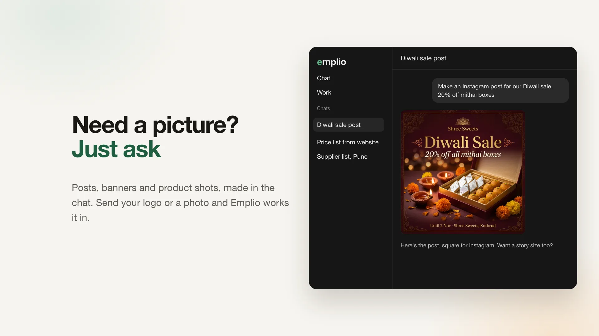

### For developers

- `emplio image <description> [--from <image>]... [--ratio <w:h>] [--out <file>]` (`emplio.image(..., from_=...)` in Python) calls OpenRouter with the `imageModel` setting (default `google/gemini-nano-banana-2.1`), saves to `/work/out/`, and views and shows the picture by itself. Cost is charged as AI usage.
- New setting type `imageModel`: any OpenRouter model that outputs images, from `GET /models?kind=image`, picked by maker like the other models.

## 1.2.67 (2026-11-18)

### What's new

- When an agent finishes, you get its answer straight away. It then keeps what worked for next time in the background, and says in one line what it kept, instead of making you wait and repeating its report. 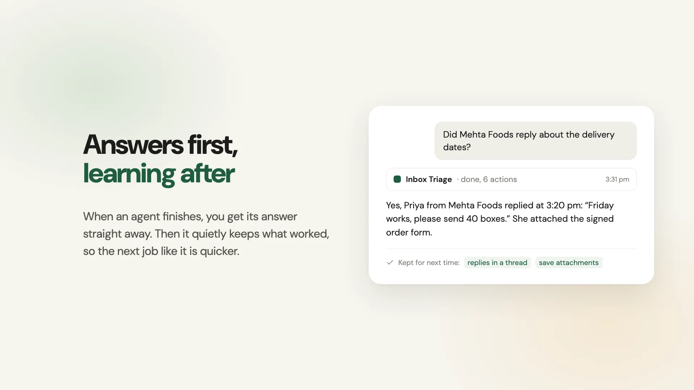
- Busy mornings no longer fail: when every cloud computer is in use, work waits a moment for one, with people chatting first. Morning briefs are spread over the first quarter hour.
- A chat follows a reply as it's written while you're at the end, and stays put once you scroll up to read.
- An agent's chat you have open now shows new work as it starts, without a refresh.
- Work on your Mac can open files Emplio hands back, like an email's attachment.
- Starting a fresh job for an agent works the first time.
- A question nobody answers for a day stops waiting, so the agent can take new work.
- Agents' notes for next time keep only what went wrong or what you corrected, not a diary of the work.

### For developers

- Jobs: the report is final when the run ends; the tool-saving nudge (`SAVE_TOOL`) runs once per job afterwards (`nudged()` reads the job's chat), leaves status and report alone, and answers in a line. `/jobs` gives `updatedAt` and `running`, which an open job chat follows.
- `computer-queue.ts`: cloud computer starts wait for room under `COMPUTER_MAX` (default 18), by priority (watched chat, work, background), and a provider "too many" goes back in line. First rounds of the day start at a per-business/person minute (`startMinute`).
- Tools: `emplio.tools.show("<area>.<name>")` shows one in full without its code; a tool that returns a value must say what in its docstring (or `->`), and listings show it.
- Python helper on a person's computer: `/work` in emplio answers and `sh()` commands is swapped for the real folder (kernel version 5).
- `emplio hand <agent> --new` reads its brief from stdin; `asks()` ignores "Question: none"; asking jobs older than a day are stopped hourly (`expireAsking`).
- `devtools()`/`socketUrl` throw `BrowserGone` for a closed Mac browser, which is dropped; `writeFile`/`writeFiles` take the repo's lock like box pushes.
- One lesson rule (`LESSON_RULE`) for agents and the reader; `scripts/clean-lessons.ts` tidies existing lessons (dry run by default).

## 1.2.66 (2026-11-18)

### What's new

- Emplio's computer now sleeps 5 minutes after it was last used, background work included.
- A command on a computer that stops answering now ends with a clear timeout instead of hanging.

### For developers

- Computers sleep after `IDLE_MS` (5 minutes) for background work too; `SERVE_MS` is gone.
- `boxOf().run` gives up 30 s after the command's own limit and returns exit 124; a box that won't wake is replaced with a fresh one.
- The session cookie is `__Host-session` on HTTPS (old `session` cookies still read until they expire); computers' own `/live` and `/git` calls skip the per-address rate limit.

## 1.2.65 (2026-11-18)

### What's new

- Someone made an admin after they started using Emplio no longer hits a "computer fault" on every command; their computer gets the admins-only files the next time it's used.

### For developers

- `catchUp` clones a repo that isn't on the box yet (e.g. `restricted` after a member is made admin) instead of failing with `fatal: cannot change to 'restricted'` and dropping the box.

## 1.2.64 (2026-11-18)

### What's new

- Installing a skill from the skill store in a chat shows the Allow card again, instead of failing with an empty error.

### For developers

- `skillsCommand` rethrows `Deferred` (an OK asked in a live chat) instead of turning it into `error: ` (#229).

## 1.2.63 (2026-11-18)

### What's new

- Skills now live in a folder called skillset, next to toolset, so the two are easy to find side by side.
- An automation keeps running as the person who set it up when Emplio tidies its file.

### For developers

- `skills/` is now `skillset/` in every repo (company, restricted, each person's); `scripts/migrate-skillset.ts --apply` moves existing ones and repoints paths in the business's files. A skill written to the old `skills/` folder is moved to `skillset/` before saving; `emplio skills use` takes either path (kernel version 4).
- `lastAuthor` passes over Emplio's own upkeep commits (`UPKEEP`), and automations with no owner are looked at again on sync; one lost its owner to the toolset move's commit.
- `writeFiles` deletes a file when its content is `null`.

## 1.2.62 (2026-11-18)

### What's new

- The Notes page also shows Emplio's tools, scripts and lists, so you can read every file it keeps, not only notes.

### For developers

- `/knowledge` lists, searches and opens `.py`, `.js`, `.ts`, `.sh`, `.json`, `.csv`, `.yaml`, `.toml`, `.sql` and `.txt` files too, skipping `__pycache__` and dot folders; non-Markdown files render as code (#226).

## 1.2.61 (2026-11-18)

### What's new

- Agents reuse the tools they already have instead of copying them, and a tool that spends money keeps asking first after it's fixed.
- Agents stick to what you asked, even when it isn't their usual kind of work.

### For developers

- The after-run check imports emplio first, so a tool that uses another tool no longer reads as "doesn't load" (kernel version 3).
- `emplio.tools.save` without `risk` keeps the tool's label; `emplio.skill()`/`lib()` raise an error naming `tools.<area>`; a run writing `skills/*/functions.py` or `lib/*.py` gets a note to save tools (#223).
- `migrate-toolset.ts` also drops lesson lines about the old way and committed `__pycache__` files.

## 1.2.60 (2026-11-18)

### What's new

- Emplio's agents now keep what they work out as tools: a job done once becomes one step the next time, and each agent's tools grow as it works. You can see them on the Team page.
- A tool that changes something or spends money asks for your OK first, the same way app actions do.
- Agents can be just for owners and admins, or just for you, as well as for the whole team.

### For developers

- `emplio.tools.save(fn, area=..., risk=...)` keeps a function from the Python session in `<bucket>/toolset/<area>.py` with every helper it uses; `from tools.<area> import <name>`, `emplio.tools.search/list`; `# risk: changes|spends` tools ask through `emplio tools allow` (#215).
- Agents live in a bucket (`--bucket company|restricted|me`) and list their `tools:`; tools and skills a run used join the list as it ends. Lessons keep only failures.
- `emplio.skill()`, `emplio.lib()`, `skills/<name>/functions.py` and `lib/` are gone: `backend/scripts/migrate-toolset.ts --apply` moves existing files into tools once.

## 1.2.59 (2026-11-17)

### What's new

- Five new apps to connect: GoDaddy, Namecheap, Cloudflare, WordPress and Wix. Emplio can manage your domains, DNS and SSL, update your website's pages, posts, store and bookings, and tell you when something changes, like a domain about to expire or a new order.

### For developers

- Own integrations for GoDaddy (204 actions, 8 polled triggers), Namecheap (64, 7), Cloudflare (2,572, 69 alert webhooks + 9 polled), WordPress (209, 8) and Wix (2,534, 22); each has a COVERAGE.md (#191).
- Spec actions build their input schema on first use, so loading every app takes about 520 MB instead of 860 MB.
- New optional settings: `CLOUDFLARE_CLIENT_ID`/`SECRET`/`OAUTH_SCOPES`, `WORDPRESS_CLIENT_ID`/`SECRET`, `NAMECHEAP_CLIENT_IP`.

## 1.2.58 (2026-11-17)

### What's new

- Emplio's first thinking on a reply now shows while it happens, instead of the reply seeming to start with an action.
- On a phone, the Chat button takes you back to the chat you were in.
- Ask Emplio who's on your team, which apps are connected or what checks are set up, and it tells you straight away.
- You can reply to text you select in your own messages, not just Emplio's.

### For developers

- chat-view/tool-calls: first reasoning renders while streaming and stays its own segment (#203).
- bottom-tabs: Chat tab goes to the last open chat (#204, fixes #198).
- chat.ts: owner's own team, apps, automations, check-ins and tasks are not "internals" (#204, fixes #197).
- automations: `add`/`update` with a name and no file returns a clear error (#204, #195).
- iOS Info.plist: camera, photo library and microphone usage text (#205, #155, #156; needs an iPhone build).
- desktop: powerSaveBlocker keeps the computer from idle sleep while the app runs (#205, #194; needs a desktop release).
- quote: Reply on selected text in the person's own messages (#206, part of #200).

## 1.2.57 (2026-11-17)

### What's new

- Emplio now hands work to its agents instead of doing long jobs itself in your chat: reading mail and apps, following a saved skill, and fixing anything that went wrong all go to an agent, so your chat stays free.
- Ask Emplio which agents you have and what each one did, and it tells you.
- Creating or changing an automation from a chat works again.
- Skills saved on the Mac app now work on the online computer too, and the other way round.
- The morning brief no longer repeats the previous evening's report when it had nothing new to say.

### For developers

- chat.ts: past 3 of Emplio's own commands in a reply to a person the rest aren't run (`HAND_IT_OFF`); its first failed command gets a note to hand off; jobs.ts MANAGER_PROMPT and the skills heading send app reads, matching skills and failures to agents; agents list shows each agent's skills; Python library `input=` adds the `-` for automations add/update, apps run and mcp call; skills and lib files keep `/work` paths on a person's own computer (#199).
- heartbeat.ts: a check-in sends only its own round's reply (#201).

## 1.2.56 (2026-11-17)

### What's new

- Links in the chat show the page's title instead of a long web address, with a mail or phone icon for email addresses and numbers. Links to Emplio's own pages open in place.
- You can watch Emplio think: a "Thinking" line you can open, which folds itself away when it's done and says how long it took. Thinking between steps sits inside the steps list.
- Code in a step's details is shown in colour.
- The chat no longer slides sideways on phones or computers.
- A helper's chat shows the helper's name, the job, and a link back to the chat that started it.
- A job waiting for your answer can be stopped with ✕, or with Close inside the job.
- Tapping Edit on a phone keeps the message you're editing in view.
- Smaller fixes: a new chat's draft is kept, Copy copies the whole reply, a message isn't erased when a file upload fails, and long words wrap.
- A job's chat no longer shows the reminder to save a skill.

### For developers

- link-title.ts: GET /link-title fetches a page's `<title>` for public addresses only (private, mapped and NAT64 IPv6 refused), with a byte cap and a day cache; chat.ts keeps reasoning parts and times them (`timeThinking`); jobs.ts `/jobs/:id/close` stops an asking job and `openJobChat` returns `from`; chat view and tool-calls changes (#193).

## 1.2.55 (2026-11-16)

### What's new

- When a helper finishes a job, it now saves how it did it as a skill with reusable steps, so the same kind of job is quicker next time.

### For developers

- jobs.ts: a finished job that didn't save or use a skill's functions.py is asked once to save one before its report (#192).

## 1.2.54 (2026-11-16)

### What's new

- Emplio now writes steps it will likely repeat once and reuses them, so long jobs go faster.

### For developers

- sandbox.ts: code mode is asked to define likely-repeated steps once as small general functions (#189).

## 1.2.53 (2026-11-16)

### What's new

- Big files made on your computer, like a recording, no longer knock your computer offline while they're saved to the chat.

### For developers

- devices.ts: files over 1 MB cross to and from a computer in 1 MB parts, so pings get through and the server doesn't drop it mid-copy (#187).

## 1.2.52 (2026-11-16)

### What's new

- Behind the scenes: better tracking of what slows a command down before it starts on your computer.

### For developers

- sandbox.ts: the slow command start log now breaks the setup time down by step (#185).

## 1.2.51 (2026-11-16)

### What's new

- Commands on your Mac no longer get stuck for minutes after the Emplio app reconnects (after waking, a network change, an app update or an Emplio update). They run straight away on the new connection.

### For developers

- devices.ts: a reconnecting computer's old connection is dropped before the new one takes its place, so its pending commands and browser links end at once instead of waiting out their timeout (#183).
- sandbox.ts: logs a command that takes over 5 s to reach its computer (time waiting its turn vs. getting the computer ready), and one that ends by timeout or a lost computer (#183).

## 1.2.50 (2026-11-16)

### What's new

- Connect 1Password and Emplio can use the logins and keys in it, just like ones saved in Emplio. They show in Passwords & keys, marked "from 1Password".
- On an empty chat, the ideas under the box now cycle through the categories by themselves (hover to pause), and fold away smoothly when you start typing.
- Email addresses in Emplio's replies show as plain text instead of link chips.

### For developers

- 1Password service-account integration: items read at the moment of use, never stored; names cached for a minute (#170).
- JobCards: CSS-only fill bar and grid-rows fold, paused on hover/focus and while typing (#180).
- Emails in replies no longer turned into link chips (#181).

## 1.2.49 (2026-11-15)

### What's new

- Emplio for iPhone is on the Downloads page: join early access through TestFlight, with three simple steps and a code to scan from your computer.

### For developers

- Downloads page iPhone card with the TestFlight invite and QR code; the Downloads menu links to it (cloud #28).

## 1.2.48 (2026-11-15)

### What's new

- Messages you send while Emplio or an agent is working no longer disappear from the chat, and ones waiting their turn stay put if you open another chat or reload.
- Agents cut off by a server update now pick their work back up by themselves, so you don't have to ask them to start again.
- When Emplio gives an agent more work, its card no longer shows the agent's previous answer as if it were finished.
- Signing in to an app from the Mac app works again, instead of failing with an empty message.
- The search box is ready to type in as soon as Integrations opens.

### For developers

- Chat view skips the "reply already ended" reload when it lacks the newest sent message; the waiting-in-line queue is kept in local draft storage; `addMessage` moves `headId` only on insert (#173).
- Depth-1 jobs still working at startup get one automatic carry-on run (20 s after start); a job's latest run reads `working` until the job finishes after its prompt (#173).
- In the desktop app the Connect button no longer falls back to navigating, which started a second OAuth flow and overwrote the first's PKCE verifier (#177). Integrations search autofocus (#176).

## 1.2.47 (2026-11-15)

### What's new

- Emplio runs quick commands on its computer the simple way again, so small checks take fewer, cleaner steps.

### For developers

- The `sh()` line in the code-mode notes is no longer agents-only: since 1.2.42 the manager wrote `subprocess.run(...)` by hand in about 1 step in 6 (#174).

## 1.2.46 (2026-11-15)

### What's new

- Steps Emplio wrote earlier that use a website keep working when it uses them again, instead of losing the browser.
- When something Emplio set up earlier is gone (it moved to another computer, or that step had failed), it's told so and sets it up again, instead of getting confused.

### For developers

- Code mode: while a chat's browser is open (`browserOpen`), every Python step gets it, so a function that drives the browser works when called later (was "no browser attached"). A `NameError` adds a note that the step that set it failed or the session is new (#171).

## 1.2.45 (2026-11-15)

### What's new

- Emplio's work in the background is now cheaper and steadier: it only wakes up when something actually changed, and it no longer opens websites on its own (it adds a task for that instead).
- Once a day it tidies up: closes tasks that are already done, removes duplicate tasks, and keeps everyone's saved rules short enough that it always reads all of them.
- Every Monday it checks the company's goals, notes how each is going and adds the next tasks to move them forward.

### For developers

- Background rounds (HEARTBEAT) always use the model set's `backgroundModel`, skip the manager prompt, and `runBash` refuses the browser when `Session.background` is set; `changesSince` (readers' notes, failed automation runs, new emails) replaces `worthWaking`, and a check-in with no changes doesn't run. The report round (or the brief when reports are off) does the daily cleanup; Monday's brief does the goals review. New `emplio person <email> rewrite prefer|profile` replaces a whole file. Background-round evals: 7 new ideal-behaviour cases, 54/54 (#167).

## 1.2.44 (2026-11-15)

### What's new

- Notifications reach the Mac app again: a reply now notifies you whenever you aren't looking at that chat, even while the app is open in the background.
- iPhone notifications arrive reliably again.
- Links to Emplio's own pages in a chat open right inside the app, with no "Open external link?" question and no new tab.

### For developers

- A reply's push is skipped only when the person's focused page is that chat (`isLooking`), not when any page streams it; APNs connects over IPv4, since IPv6 to Apple mostly failed with "h2 is not supported" (#160).
- `ownPath()` routes emplio.app and relative links through the app's router (#165).

## 1.2.43 (2026-11-15)

### What's new

- When an agent needs a decision from you, it asks you itself: its question shows above your message box with answers to tap, and your answer goes straight to it, so it gets back to work sooner. Answer there or in the agent's own chat; either way the question closes in both.
- Before asking, agents look back through what you already said in your chat, so you're asked less.
- Coming back to a chat that's still working jumps straight to where it is, instead of quickly replaying every step.

### For developers

- Agents (one level down) ask with `emplio ask`; the job goes to `asking` without waking Emplio, `/conversations/:id/working` carries its open cards, and `POST /jobs/:id/answer` posts the answer in the job's chat. When the person last wrote from their phone, Emplio still relays the question (#162).
- Reopening a chat mid-reply sends the reply so far merged (words joined, each command's latest progress only), with gapless sequence numbers after it (#161).

## 1.2.42 (2026-11-15)

### What's new

- Emplio and its agents now each get only the instructions their part of the work needs, so every step costs less: about a third to a half less read per step, with the same results in our tests.
- Agents get the how-to for working a website when they first open one, instead of with every step.
- Saving how someone likes things done works whichever way Emplio words it.

### For developers

- System prompt split by role: `sandboxPrompt(s, agent)`, `agentRules(ctx, automation, agent)` and `emplioPrompt({ agent })`; jobs skip the voice rules and the manager sections, the manager skips the hands-on sections; the browser site guide (`browserGuide`) rides on a reply's first browser result.
- `emplio person` takes `prefer|profile <email>` in either order.
- Code-mode translator: a backticked flag alone and short flags (`-i`) come out as Python; the evals' fake computer no longer turns a folder into a file on first read (background check-ins 88% → 97%).

## 1.2.41 (2026-11-14)

### What's new

- Emplio now works in Python: it keeps what it has loaded from one step to the next and uses its own tools straight from its code, so long jobs with many steps finish faster, in fewer steps and for less.
- Files Emplio makes are kept on its computer to keep working on, and saved in Files as they change. It shows you the finished file in the chat with its answer, instead of every draft.
- When an agent finishes a job, Emplio sees which files it already showed you, so it no longer asks the agent to send them again.
- Excel, Word and PowerPoint work is ready on your own Mac or Windows PC too: what Emplio needs installs by itself the first time.
- Mac app: the back and forward buttons update without a warning when you move between pages.

### For developers

- Code mode, on by default (`CODE_MODE=0` turns it off): a Python session per chat and job (`backend/src/python/kernel.py`), the `emplio` library (`backend/src/python/py/emplio`), live answers at `POST /live/<token>/<tag>`, JSON answers for `db`, `web` and `tasks` when the library asks, and every prompt, help and error text written as Python calls (`inPython`) (#153).
- `/work/out` stays between commands; changed files are stored in Files without showing; `emplio files show <name or id>` shows one (#153).
- Evals run in code mode (`EVAL_CODE_MODE=0` for bash); workday report files hold real contents (#153).

## 1.2.40 (2026-11-14)

### What's new

- When one of your agents finishes a job that used a browser, its browser tab now stays in your main chat until that browser closes, instead of vanishing the moment the job ends.

### For developers

- `/conversations/:id/working` also returns finished jobs whose browser is still live (`status: "done"`); the strip over the message box shows only jobs still working or asking (#151).

## 1.2.39 (2026-11-14)

### What's new

- Reply to Emplio straight from a notification on your Mac: type in the notification and send, without opening the app. Emplio's answer arrives as the next notification.
- The same on iPhone, once the next version of the iPhone app is out: press and hold a notification, type, send.
- On the Mac app, Update and Restart to update now really restart into the new version. Until you have this version, quit Emplio completely from the menu bar icon and open it again to update, or download the Mac app again.
- The Mac app reconnects by itself when its connection to Emplio quietly drops.
- A question waiting for your OK is no longer skipped by Emplio's own updates in the chat, only by a message from you.

### For developers

- Notification replies (#148): `POST /push/reply` (a per-chat token in the push, no cookie) for the iPhone app; the Mac app sends `notify.reply` over its link. Both go through `replyFromNotification` in `backend/src/chat.ts`. The iPhone part needs a new app build (`AppDelegate.swift` owns the notification delegate).
- Mac app: `restart()` marks the app as quitting before `autoUpdater.quitAndInstall()`, which closes every window first; the window's hide-on-close stopped it (#149).
- Desktop apps 0.2.4 ship #148, #149 and the link ping from #144.
- `moveOn` runs only for messages the person wrote (#147).

## 1.2.38 (2026-11-14)

### What's new

- If a chat had to use the cloud browser while your Mac was away, it moves back to the browser on your Mac as soon as your Mac is back, on the same page and still signed in.
- Sites you sign in to in the browser on your Mac are now signed in in the cloud browser too, not only the other way round.

### For developers

- `browserFor` in `backend/src/browser.ts` moves a chat's cloud browser to the person's computer when it reconnects (`moveToComputer`): stops it (saving state and page), starts the computer's Chrome and opens the same page. A cloud browser started because the computer's Chrome failed is not moved again (`stayInCloud`).
- Saved sign-ins are restored into every browser, the cloud one included; `RESTORE_SIGN_INS` is gone. The cloud one never got sign-ins made in the computer's Chrome.
- The desktop app pings the server itself and reconnects after 25 s of silence (`desktop/src/link.js`); ships with the next desktop release (#144).

## 1.2.37 (2026-11-14)

### What's new

- Web addresses in chat now show as short highlighted links with a link icon; hover to see the whole address.
- Type @ to point work at one of your agents.
- A chat that stopped showing progress now catches up by itself once the work is done, without a refresh.
- The suggestion cards on a new chat get out of the way once you start typing.
- On a phone, the Settings tabs scroll sideways, so every tab can be reached.
- Files with several dots in a row in their name now open and download.
- Usage details now count from when your current plan began, so a plan bought mid-month starts fresh.

### For developers

- `emplio apps run` checks the action's required fields before showing Allow, so a blank `{}` is turned back at once (#139, fixes #93).
- `pointerAt` refuses only a real `..` folder step, not any two dots (#139, fixes #32). Job cards hide while typing (#128); settings tab row scrolls on phones (#91).
- Links in sent messages and replies render as `ShortLink` chips; `@` mentions include agents (`emplio hand <slug>`); the chat stops waiting when the server says the reply ended (#142, fixes #33, refs #56).
- iPhone app: native file saving through Filesystem + Share and keyboard resize (#142, fixes #136, #34). These need a new app build; older builds show "Update the Emplio app to save files."
- Billing usage chart and per-person totals count from `periodStart` (Emplio Cloud, fixes #92).

## 1.2.36 (2026-11-14)

### What's new

- Sites you sign in to in the browser on your Mac now stay signed in when you close the laptop and carry on from the website.

### For developers

- While a desktop app's browser runs, the server checks its script-hidden (`httpOnly`) cookies every minute and saves the browser state when they change (`keepSignIns` in `backend/src/browser.ts`). Sleep ends that browser at once (`powerMonitor` `suspend`), so the save at its stop never ran and the cloud browser started from older sign-ins (#134).
- Desktop apps' version is 0.2.2 (#133).

## 1.2.35 (2026-11-13)

### What's new

- With the Mac app, Emplio can now use programs that live on your Mac, like a music app's own tools. Tell Emplio the command to run, and it starts the program when it needs it. The app asks you first, on your Mac, the first time.

### For developers

- Local MCP servers: `emplio mcp add <name> --local "<command>"` stores `local:<command>` in `mcp_servers.url` (no migration). The desktop app starts it in a login shell (`desktop/src/mcp.js`) and relays its lines over the device link (`mcp.open`, `mcp.send`, `mcp.close` and the `mcp.data`, `mcp.closed` events); the server stays the MCP client through `DeviceTransport` in `backend/src/mcp.ts`. Only the person who added it can use it, a new command needs their OK on the Mac, and it starts fresh for each use (#131).

## 1.2.34 (2026-11-13)

### What's new

- Signing out and then signing in as someone else in the same tab no longer makes every message fail with "Something went wrong".

### For developers

- `useMe` closes `chatTransport` when `/auth/me` reports a different signed-in person than it last saw. The chat socket's sign-in is fixed at its handshake and logging out deletes that session, so every send on the old socket got "Not logged in" (#129).

## 1.2.33 (2026-11-13)

### What's new

- When Emplio uses the browser on your Mac or PC, you can now watch it live on the website too, not only in the app.
- Taking control of that browser from the website now clicks where you point, even while the app is showing the same browser.
- In the Mac and Windows apps, dialogs, menus, popovers and tooltips now show on top of Emplio's browser instead of hiding behind it.

### For developers

- `liveUrlOf` builds the live view link from the same public address as the rest of the device links (`apiBase`: `PUBLIC_API_URL`, else `WEBHOOK_URL`), so a server with only `WEBHOOK_URL` set no longer hands out a `localhost` link (#111).
- The live view sends frame sizes in the page's CSS pixels (screencast size divided by `cssVisualViewport.zoom`): the desktop app zooms its browser to fit its panel, and clicks were placed in screen pixels, landing short (#111).
- `browser-panel.tsx`: the desktop browser steps aside while any open Base UI floating part (`[data-open]`, fixed or absolute) overlaps it, checked at once on open through a MutationObserver. The old check looked for Radix's `data-state="open"`, which Base UI doesn't set (#111).

## 1.2.32 (2026-11-13)

### What's new

- When Emplio asks you something about a draft (a post, an email, a bio) while working on your Mac, the draft now shows on the question card above the buttons, so you can read it before you answer.

### For developers

- `emplio ask` read stdin with `read -t 0` and `timeout`, which the Mac's bash 3.2 lacks, so a heredoc was dropped on desktop computers; it now reads lines with a 1 s wait each (#125).

## 1.2.31 (2026-11-13)

### What's new

- The homepage now offers the Emplio app for the computer you're on: Mac, Windows or Linux.
- The plans dialog now says every plan unlocks the **Smarter** and **Best** AI, which you can then pick in Settings, Agent, Quality.

### For developers

- Homepage download line follows the visitor's system (`AppDownload`; click event `<system>_download`), hidden on phones, tablets and inside the app (cloud #23).
- Plans dialog badge and the trial's Quality lock note reworded for the Standard default (cloud #24).

## 1.2.30 (2026-11-13)

### What's new

- When a new version of the Mac, Windows or Linux app is ready, it now shows in the same bar at the top as website updates, with an **Update** button that restarts the app into the new version. Choosing Restart to update from the menu still works too.

### For developers

- Desktop app 0.2.1: the preload exposes `emplioDesktop.update` (`ready`, `onReady`, `restart`); `NewVersionBar` shows the app's update first and falls back to the website bar (#123).

## 1.2.29 (2026-11-13)

### What's new

- Emplio for Windows and Emplio for Linux now have their own pages, like the Mac one: what the app does, how to install it in three steps, and answers to common questions. Open them from **Learn more** on the Downloads page or the Downloads menu.

### For developers

- `/downloads/windows` and `/downloads/linux` added; all three app pages share one component with search-friendly titles, descriptions, social cards and app, FAQ and breadcrumb data, and are in the sitemap (#117).

## 1.2.28 (2026-11-13)

### What's new

- When usage runs out partway through a piece of work, Emplio now stops right away and sends one last message saying what's done, what's left, and that it will carry on as soon as usage is added, instead of finishing the whole job first.
- The free trial for new businesses is now twice as big.

### For developers

- After each command, a paused business (`credit.pausedReason`) ends the run's commands via `failureGuard().end(outOfUsage(reason))`, so the next step must be the last message (#109).
- Free trial lot raised from $0.50 to $1 (`TRIAL.usd`, cloud #20).
- Toasts and in-app notes use the app's font: `fontFamily: "inherit"` on the sonner Toaster, which sets the system font itself (#120).

## 1.2.27 (2026-11-13)

### What's new

- The Mac, Windows and Linux apps now update themselves: from version 0.2.0 on, a new version downloads in the background and is put in place the next time Emplio isn't busy, or when you choose Restart to update. If you have an older app, download 0.2.0 from the Downloads page once.
- Signing in with a popup ("Log in with Facebook", Google and the like) now works in the app's browser on your own computer.

### For developers

- Desktop apps 0.2.0 check `GET /desktop/update/:kind?version=` (hosted server): macOS uses Squirrel with a signed zip; Windows and Linux fetch the new folder beside the install, check its SHA-256 and swap it in after quitting (`desktop/src/update.js`, #110).
- The desktop browser lets Chromium create popups itself (`createWindow`), keeping `window.opener`; a page that closes itself closes its tab (#118).

## 1.2.26 (2026-11-13)

### What's new

- Emplio now runs on a fast, lower-cost AI by default. The Quality choices in Settings are renamed: **Free**, **Standard** (the new default), **Smarter** and **Best**. If you never picked one, you're now on Standard; choose **Smarter** in Settings, Agent, Quality to get the stronger AI for chats back.

### For developers

- Quality (`modelSet`) defaults to `save` (Claude Haiku for every role) instead of `default` (Sonnet chats). Stored values are unchanged; labels are now Free / Standard / Smarter / Best, and `emplio settings` lists each value with its label (#115).

## 1.2.25 (2026-11-13)

### What's new

- Older websites that reload the whole page when you press Save (many government portals, accounting and booking systems) are now faster for Emplio to work with: after saving one record on the page, it can save the next ones straight from the form instead of clicking through every field, keeping each page's own security codes.

### For developers

- `emplio browser calls` now records whole-page form posts (listed as `returns page`, status 302 when redirected); sign-in forms are never listed or saved. `send` to a form on the open page sends the whole form with the given fields replacing the visible ones, hidden fields always the page's own; only that form's exact address counts; file-upload forms are refused. Web pages in replies come back as their text (#112).
- README for engineers (#105).

## 1.2.24 (2026-11-13)

### What's new

- Emplio for Windows: download it from the Downloads page, unzip it and open Emplio. Like the Mac app, Emplio can then do its work on your own PC while it's on, fenced into its own Emplio folder: it can't see your passwords, browser data or personal folders.
- On a Mac, attaching files, opening saved files and using saved skills now work the same as on the cloud computer.
- Work moves cleanly between your own computer and the cloud one: Emplio knows which one it's on, and folders it copied in with their own history now come along.

### For developers

- Windows desktop app: commands run in Git for Windows' bash (fetched once, SHA-256 checked) at Low integrity (`desktop/src/fence-win.js`); the app reports `win32-getting-ready` until a fence test passes, and `deviceFor` gives work to `darwin` and `win32` (#108).
- The computer note moved from the cached instructions to each message's note (`computerNote`); a mid-reply switch is said in the command result (`computerChanged`).
- `EMPLIO_WORK` replaces `/work` written into the `emplio` script; request arguments are mapped back to `/work`; `stageScript` uses `wc -c` and sets nested `.git` folders aside as `.git.emplio`.
- The desktop apps fetch their own Python (python-build-standalone); kept scripts are Python.

## 1.2.23 (2026-11-13)

### What's new

- Finished with a chat? Tap the tick next to it in the list, or Done at the top of the chat, and it moves into a Done list at the bottom. A note with Undo lets you take it back, and anything new in the chat brings it back by itself. 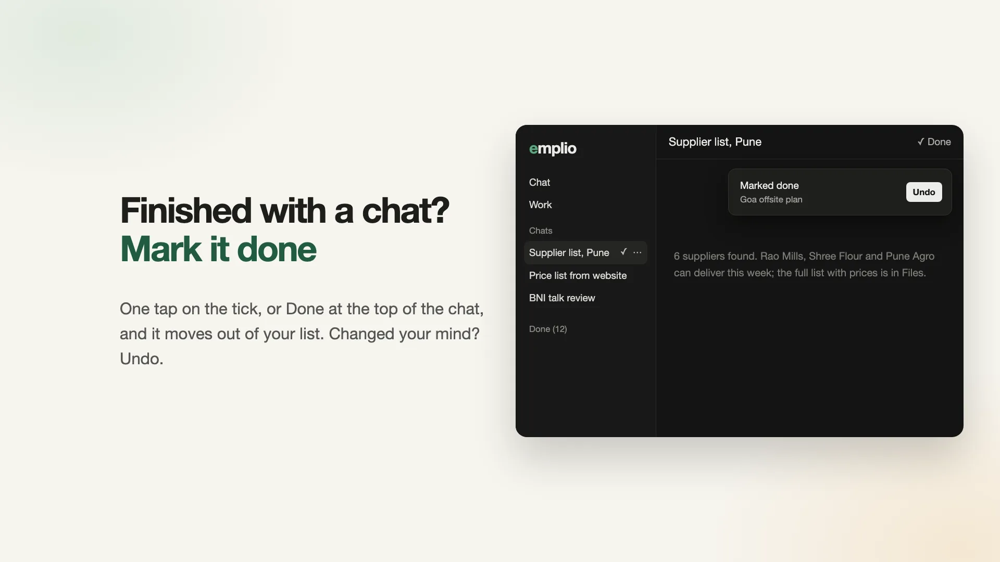
- While you're working in Emplio, finished work and requests for your OK now pop up inside the app, at the top right (along the top on a phone), with a button to open them. Your phone and computer stay quiet then; when you're away they still notify you as before. 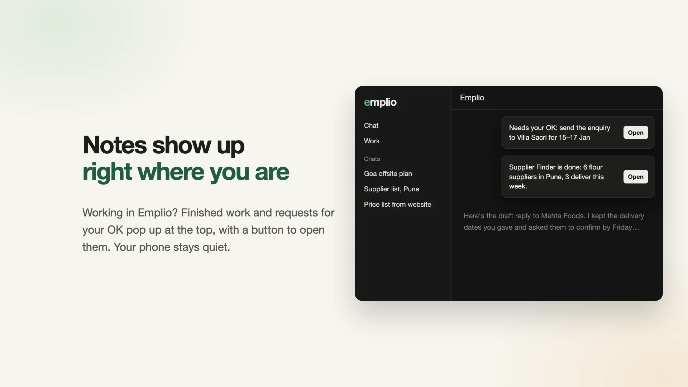

### For developers

- `push.ts` `route()` tries a new `app` sender first: `live.ts` `showInApp()` sends `{ type: "note" }` over `/events` to any open app that reported itself in front of the person (`{ looking: path }` on focus, blur, visibility and page changes), skipping the chat they're already on; when one takes it, the Mac, web push and phone senders are skipped (#107).
- Chats: "Archive" is now "Done" (a hover tick in the sidebar, a Done button in the chat header, "Not done" to undo); same `archivedAt` underneath. `useArchiveConversation` shows a "Marked done" toast with Undo.
- Toasts sit at the top right under the top bar (`components/ui/sonner.tsx`), along the top on phones.

## 1.2.22 (2026-11-13)

### What's new

- Emplio for Linux: download it from the Downloads page, unpack it and open `emplio`. It's Emplio in its own window, with its notifications on your desktop. For 64-bit PCs.

### For developers

- `desktop/build/linux/emplio` starts the app (`emplio-app`), adding `--no-sandbox` only where Ubuntu blocks Chromium's own sandbox and `chrome-sandbox` isn't set up as root.
- The Linux archive no longer carries macOS file attributes (`tar --no-xattrs --no-mac-metadata`).
- Tried on Ubuntu 24.04 (x64): opens to the sign-in page.

## 1.2.21 (2026-11-13)

### What's new

- The Mac app now runs on Intel Macs as well as Apple silicon, from macOS 11 (Big Sur). Macs on macOS 11 or 12 get their own download, linked under the main button.
- Talking to Emplio with your voice now works in the Mac app: it asks for the microphone the first time.
- The Mac app can ask to use your Documents and Downloads folders, as it already could for Desktop.

### For developers

- `desktop`: `npm run dmg` builds a universal app (Electron 45, macOS 13+); `npm run dmg:older` builds it on Electron 37.10.3 for macOS 11 and 12. Mac app 0.1.1 (#104).
- Entitlement `com.apple.security.device.audio-input`; microphone, Documents and Downloads prompts in `info.plist`.
- Chrome for Testing is fetched for the Mac's own chip, and only on macOS 12 or newer.
- `/download/mac-older` serves the older-Mac DMG; `DownloadButton` and `POST /downloads` know `mac-older`.

## 1.2.20 (2026-11-13)

### What's new

- Emplio can use the browser on your Mac again. Before this, jobs that needed a website stopped and said your Mac's browser wasn't reachable, even with the app open.

### For developers

- `devices.ts` `apiBase()` falls back to `WEBHOOK_URL` before localhost, so the link to the Mac's browser (`/device-cdp/...`) is the public address when the server sets only `WEBHOOK_URL` (#102).

## 1.2.19 (2026-11-13)

### What's new

- We now count who downloads the Emplio desktop app, and for which computer, so we know where to put our effort next.
- Groundwork for Emplio on Linux: the app can now be built for Linux. It isn't on the downloads page yet.

### For developers

- `DownloadButton` sends `app_downloaded` (platform, from) to PostHog and `POST /downloads` to the cloud, which keeps an `app_downloads` row with the signed-in user (#101).
- `/download/[platform]` passes through any desktop app the backend serves (`mac`, `linux`).
- `desktop`: `npm run linux` packs `out/Emplio-linux-x64.tar.gz`. Only a Mac gets Emplio's commands and browser (`deviceFor(userId, true)`); a Linux computer gets notifications only.

## 1.2.18 (2026-11-13)

### What's new

- A new chat on your phone now fits the screen: the starting jobs are a row of topics you swipe through, with three ideas under each, and everything sits centred.
- The ideas change through the day and from day to day, and "Show other ideas" gives you a fresh set.

### For developers

- `JobCards` in `first-run.tsx` is now category pills plus three jobs from a few per category, ordered by hour and rotated by day of year (#98).
- The empty chat centres with `my-auto` so tall content scrolls from the top.

## 1.2.17 (2026-11-13)

### What's new

- In the Mac app, the Back and Forward buttons now work and line up with the window buttons.

### For developers

- `DesktopHistory` renders after the sidebar so its no-drag area wins over the sidebar's window-drag row (#99).

## 1.2.16 (2026-11-13)

### What's new

- The Emplio Mac app now opens without any "damaged" warning: it is signed and checked by Apple.
- In the Mac app, Emplio's browser steps aside while a window such as Settings is open, so nothing is hidden behind it.
- The Mac app has Back and Forward buttons next to the window's red, yellow and green buttons.

### For developers

- `npm run dmg` in `desktop/` signs with the Developer ID, turns on the hardened runtime, notarizes and staples the app and the DMG (`build/sign-notarize.sh`, `build/entitlements.plist`); credentials come from the `emplio-notary` keychain profile (#88).
- The browser panel tells the app to hide the pane while a dialog or alert dialog is open (#95).
- Back and forward buttons beside the traffic lights in the Mac app, from the Navigation API (`components/desktop-history.tsx`).

## 1.2.15 (2026-11-13)

### What's new

- Everything in Emplio now moves a little more smoothly: buttons, menus and switches ease between colours, and bars fill gently.
- A window that opens on top of another window now dims the one behind it too.

### For developers

- Global soft transitions in `globals.css` (zero-specificity `:where`, colour/opacity/shadow only, off under reduced motion), `interpolate-size`, animated `
`.
- Dialog and alert-dialog backdrops use `forceRender` so nested dialogs dim what is behind them.

## 1.2.14 (2026-11-13)

### What's new

- A new chat now offers real jobs to start with, like checking competitors' websites, drafting replies to enquiries, or a price list made from your website. Tap one and Emplio starts. 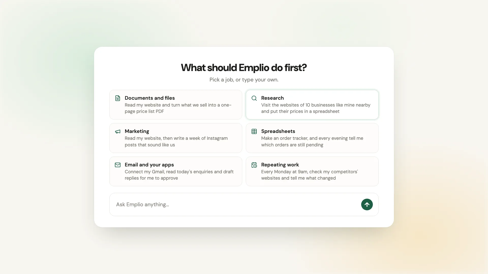
- Before you connect Google Calendar, Docs, Sheets, Meet or Analytics, Emplio shows what it will do and how your data is used. Your Google data is never used to train AI, and disconnecting also removes Emplio's access in your Google account. 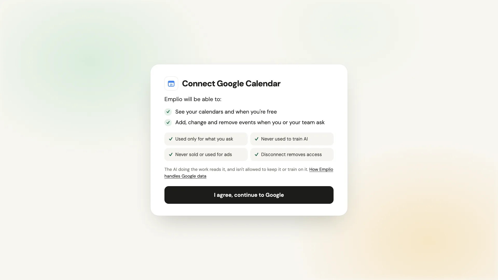
- Emplio now only uses AI services that don't keep or learn from your data.
- Google Calendar asks for less: Emplio can see your calendars and manage events, but can't create, delete or share whole calendars.
- Ask Emplio to change a setting or rename your business in the chat. It always asks for your OK first.
- Settings has new Business and You tabs for your business name and your own name, email, phone and Telegram.
- New businesses get a free trial to try Emplio with.

### For developers

- First-run flow (#85, cloud #14): free trial lot per person (ref = sha256 of the normalised email), Haiku lock while on it, console kill switch and `FREE_TRIALS_PER_DAY` cap; welcome dialog, job cards, Telegram offer after the second message; plans dialog in the app.
- Google sign-in at `/auth/google` (needs `GOOGLE_SIGN_IN=1` plus keys; off on live until Google verifies the app); its callback falls back to `WEBHOOK_URL` when `PUBLIC_API_URL` isn't set (#89); `safeNext` keeps sign-in redirects on this app's own pages.
- `emplio settings` (list, `set <setting> <value>`, `set name`, `set my-name`): every change waits for an Allow card with no "Always allow"; API keys refused.
- Google verification: Calendar scopes are `calendar.events` + `calendar.readonly`, admin actions (`acl_*`, `calendars_*`, calendar list writes) dropped; `GET /connect/:app` shows a disclosure page for Google apps until `agreed=1`; disconnect revokes the token at Google (`oauth.revoke`); every OpenRouter call sends `provider.data_collection: "deny"`. Privacy policy has a "Google user data" section (`/privacy#google`).

## 1.2.13 (2026-11-13)

### What's new

- Emplio now has a Mac app. It gives Emplio a browser of its own on your Mac, runs its work right on your computer for faster replies, and keeps going from the menu bar after you close the window. Get it from the Downloads page on emplio.app. 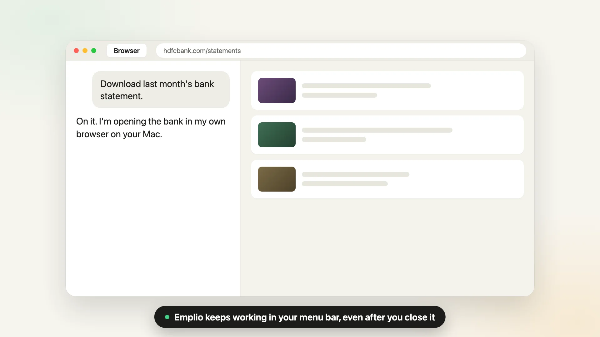
- Get a notification the moment work is done or Emplio needs your OK, on your Mac or in Chrome, even when Emplio isn't open. Turn it on when Emplio asks. 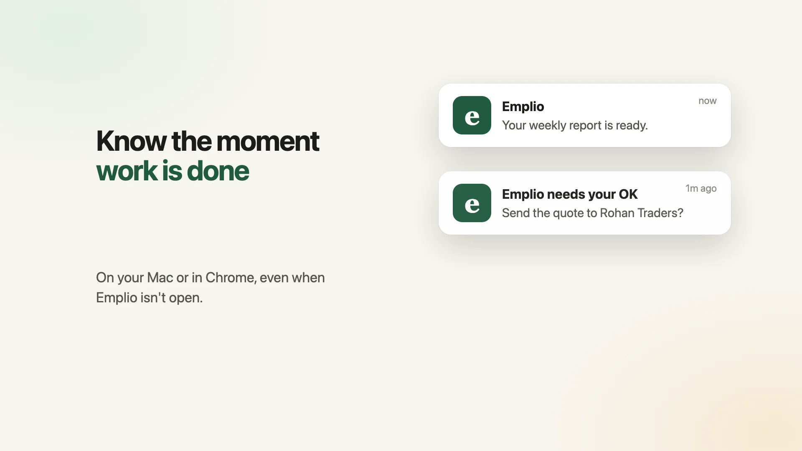
- The browser you watch on the web now looks the same as on the Mac: tabs, an address bar, and the full height of the page.

### For developers

- Desktop app (`desktop/`, Electron): the agent's browser is an embedded Chromium pane reached over the device link, with Chrome for Testing as a backup, sign-in save and restore, commands run on the Mac when it is online, an offline page, and a menu-bar background mode with a hidden host window (#86).
- Web Live view (`backend/src/browser-host.ts`) draws tabs and an address bar and fits the page to the panel height over CDP (#86).
- Mac app and Chrome notifications: `web_push_devices` table, `backend/src/webpush.ts`, a service worker, and `VAPID_PUBLIC_KEY`, `VAPID_PRIVATE_KEY`, `VAPID_SUBJECT` in the server settings; `backend/scripts/vapid-keys.ts` makes a pair (#86).
- `/download/mac` passes the Mac app through from storage so the browser stays on the site; the `/downloads` pages and the storage route live in the cloud folder (#86).

## 1.2.12 (2026-11-12)

### What's new

- Emplio now runs a team: it hands each piece of work to the right agent, checks what comes back, and stays free to talk with you while they work. Ask for more and the same agent carries on. 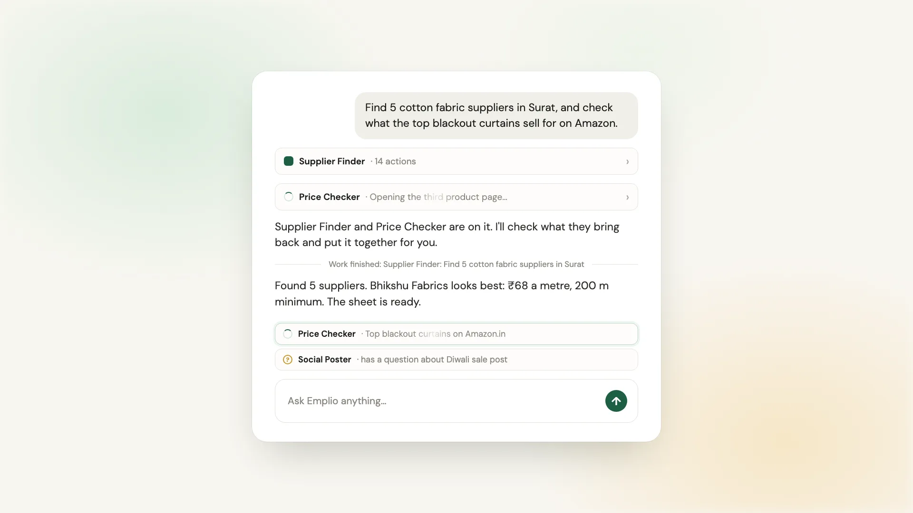
- Watch your agents work: each agent's browser shows beside the main chat, a tab each. 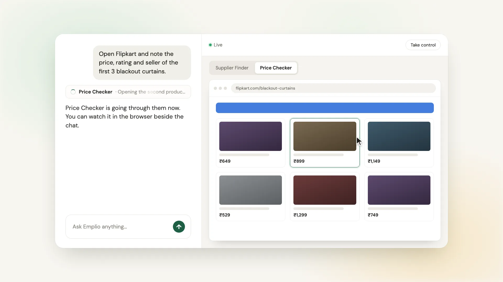
- Above the message box, a short list shows which agents are still working or have a question, however far up you asked. Tap one to open it.
- When work finishes, the line in the chat says which agent finished what.

### For developers

- Manager mode (#74): Emplio's main chat plans, hands off, checks and relays; agents do the work. `emplio hand <agent>` carries on that agent's latest job in the chat, `--new` starts a fresh one (refused while it's working or asking). No top-level `myself`; Emplio's own chats can't use the browser; soft command reminders only. Emplio does work itself only when the chat, its notes and its jobs' reports cover it in two commands or fewer, and writes final collated reports itself as one markdown file.
- `[SILENT]` replies (after sending work back, answering a job, or while a related job is still running) mark nothing unread and send no push.
- `GET /conversations/:id/working` lists a chat's top-level jobs that are working or asking (`WorkingJob`), with `browser` when its live view is up; it feeds the strip and the browser panel's tabs. A finished job that carries on takes the new brief's first line as its name and chat title.
- New evals: `evals/manager` (32 single decisions) and `evals/workday` (whole conversations on a fake computer); `bun evals/workday/report.ts old.jsonl new.jsonl` compares runs. Right call 72% → 94–98%; workday steps right 71% → 93%.

## 1.2.11 (2026-11-12)

### What's new

- When Emplio asks for your OK, the card names the action in plain words, like "Create a pull request".
- The Reply button on text you select stays with it while you scroll, and slides over when you select more or something else.

### For developers

- Own-provider actions get a `title` from their name (`actionTitle`, shared); cards saved with the code name show it too (#82).
- Quote button follows the selection on scroll (page-wide captured listener, once a frame), hides only while it's out of the chat's view, and fades in place so the next selection glides; no glide while scrolling (#83).

## 1.2.10 (2026-11-12)

### What's new

- After an update, a short card shows what's new, with a picture for each change. Swipe or tap Next to go through it, or Skip to close it. 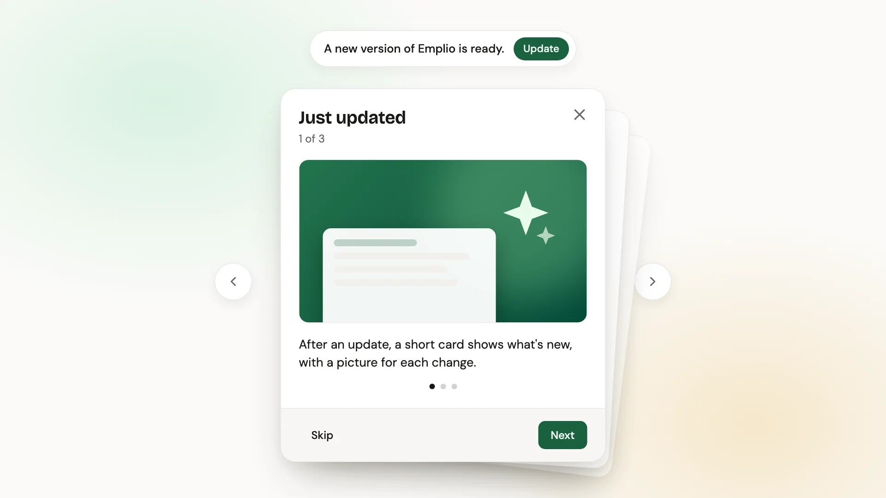

### For developers

- A "What's new" line can end with a picture or GIF, ``. `GET /changelog` now returns `changes` as `{ text, image? }`, and each device shows one slide per new pictured line after an update. GitHub release notes link pictures to the raw file.

## 1.2.9 (2026-11-12)

### What's new

- The card where Emplio asks for your OK is shorter: it never covers more than half the screen, the short details come first, and long text like an email shows a few lines with "Show all".
- The card's edges and shadow no longer look cut off in light mode.

### For developers

- Approval card: short fields first, long values (over 4 lines or 240 characters) clamp to 4 lines with Show all / Show less, also in the answered card; holder capped at `min(28rem, 50dvh)` and no longer scrolls, so it doesn't clip the card's ring and shadow (#79).

## 1.2.8 (2026-11-12)

### What's new

- When Emplio asks for your OK on something long, like an email or a pull request, the Allow and Deny buttons now always stay on screen. The details scroll above them.
- In spreadsheets, double-click the edge of a column heading to make the column fit its longest text, like in Excel.

### For developers

- Waiting approval card: header and buttons don't shrink, the fields scroll between them; the per-field height cap is dropped there so there's one scroll area (#75).
- Sheet viewer: double-clicking a column's resize handle fits it to its longest shown value, capped at 1000px; rows keep double-click to reset (#77).

## 1.2.7 (2026-11-12)

### What's new

- Long work no longer stops halfway and says it's done. When a helper runs out of steps it keeps going on its own, for up to 2 hours, and if it still can't finish it says so plainly.
- Helpers working through big documents save what they find as they go, so nothing has to be read twice, and they build the file you asked for step by step.

### For developers

- Jobs carry on in a fresh run after the step limit until `JOB_MINUTES` (now 120) is up; a run cut off by the step limit or by time reports "not finished" with status `failed`, not `done`. Default `maxSteps` 60 → 100. A timed-out run (`aborted`) no longer counts as completed. Job rules: extract big documents into a small file once and build the result as you go (#72).

## 1.2.6 (2026-11-11)

### What's new

- Buying a plan after the free period now starts the month's usage at 0%. Any free usage you had left is kept as extra usage.

### For developers

- Emplio Cloud billing: a first plan payment moves leftover founding, pass or free credit into extra usage, so it no longer counts in the month's percentage; a cloud migration fixes businesses already on a plan.

## 1.2.5 (2026-11-11)

### What's new

- When a new version is ready, the button now says "Update".
- The install guide shows how to check the install script before running it.

### For developers

- New-version bar button reads "Update" instead of "Refresh"; it still reloads the page (#69).
- README: the install checksum check is a visible section with a direct link to `install.sh.sha256` (#68).

## 1.2.4 (2026-11-11)

### What's new

- Emplio works better on a phone. Nothing hides under the clock or the home bar any more, the file viewer and live browser have a Back button, sheets don't throw the keyboard over themselves, and the menu now opens from a button at the top left of every page.
- Download and Export to Excel now work in the iPhone app: they open the share sheet, so you can Save to Files, AirDrop or Mail.
- Closing the keyboard no longer jumps the chat to the end.
- The iPhone app now shows your usage.
- DeepSeek models can be picked in Settings.
- Before installing a skill from the store, Emplio can read it first and install only one that fits.

### For developers

- Phone layout: one `--safe-top`/`--safe-bottom` pair for safe areas, top-left menu button (`SidebarTrigger`) on phones, bottom bar down to four tabs, sheet and dialog fixes; downloads in the app go through `saveFile` and the share sheet; chat keeps its distance from the end across resizes (#61).
- DeepSeek added to `MODEL_PROVIDERS` (#54).
- `emplio skills show <owner/repo/skill>`: read a store skill without installing it (#55).

## 1.2.3 (2026-11-11)

### What's new

- Searching your chats now shows chats whose name matches first, so typing "posthog" finds the chat called "Install PostHog MCP" at the top.
- New apps Emplio can work in: Google Business Profile (your listing on Google, with reviews first: read them, see the average, reply), Google Search Console, Google Analytics and Bing Webmaster Tools.
- Swipe can now start automations: a new invoice, a payment, an overdue invoice, low stock and more.

### For developers

- `/search` lists title matches first, then message matches from other chats; `emplio history search` is unchanged (#59).
- Google Business Profile as an own integration, 98 actions and 5 polled triggers; needs Google's Business Profile API access approved before it works (#58).
- Google Search Console (13 actions, 8 triggers) and Google Analytics 4 (190 actions, 9 triggers) on the shared Google sign-in (#60).
- Bing Webmaster Tools, all 62 methods as actions plus 4 polled triggers, connected with a pasted API key (#62).
- Swipe triggers: 7 from Swipe's webhook (set up with `get_webhook_setup`) and 8 polled (#57).

## 1.2.2 (2026-11-11)

### What's new

- Emplio can now upload files on sites that hide the spot to drop a file, like a Reddit community icon or a YouTube profile picture. It clicks the site's Upload button and hands over the file.

### For developers

- `emplio browser upload` takes a file box or the button that opens one; for a button it clicks it with the page set to give any file box it opens the files. The agent's browser guide now lists the command (#63).

## 1.2.1 (2026-11-11)

### What's new

- The card under a reply now only shows when one tap can answer it, and waits until Emplio's agents have finished. No more buttons like "Send the repo" that can't actually answer.
- Emplio is better at saving a skill when it learns how to do something, and suggests making an agent when the same kind of work keeps coming back.
- When Emplio closes its browser, it really closes, so a phone-size page it set up for a test doesn't stick around.

### For developers

- The next-step card writer moved to `backend/src/next-step.ts`; evals live in `backend/evals/` (run with `bun run eval evals`, results to Braintrust) with a repo skill on adding one. New dev dependencies: `braintrust`, `@braintrust/bt` (#23).
- `emplio browser close` stops the chat's browser after the command, saving sign-ins first (#50).
- Docs: Google Search Console ownership tag (#45).

## 1.2.0 (2026-11-11)

### What's new

- On phones, Emplio feels more like a phone's own app: sheets follow your finger and close with a quick flick, the bottom bar is frosted glass with your lists scrolling under it, and buttons give a little when pressed.
- If your phone is set to reduce motion, things now fade instead of sliding or zooming everywhere in the app.
- "Allow" requests now wait just above the chat box, so they stay in view however much is written after them. Once answered, each shows in one line whether it was allowed and how it went.
- Emplio no longer asks you to tap Allow after you already have.
- The next-step card no longer makes the chat jump, and editing a tapped answer shows just your answer.
- On phones, the buttons under a sent message no longer sit on top of the reply.
- When Emplio reports a problem, the step it took now shows in its list of actions.
- Emplio can test a website at phone size: its browser keeps the page size it was asked for.

### For developers

- Approvals have their own `approvals` table and `GET /conversations/:id/approvals`; cards are no longer part of a command's result, so the model never reads them. Cards left waiting by a restart are closed at the next start (#41).
- `emplio browser set viewport` is replayed before each later browser command for that chat's browser, and a hosted browser that won't change size is restarted at the asked size; `emplio browser viewport W H` is a short form (#44, #47).
- A browser being stopped is no longer picked up again (#42).
- `emplio report` shows in a reply's actions (#39).
- The phone app adds `@capacitor/haptics`; taps need the next iPhone build (#46).
- `/site/...` hands over to Emplio Cloud's pages, not found without the cloud folder (#43). Commits made as "Emplio" are exempt from the CLA check (#31).
- Database migration: `approvals`.

## 1.1.0 (2026-11-09)

### What's new

- After a reply, a small card sums up where things stand and asks what to do next. Tap an answer, or press Cmd+Enter (Ctrl+Enter on Windows) for the first one. Close it if you don't need it.
- Stripe, Asana, ClickUp, Airtable, HubSpot and Calendly now connect with a key you paste in.
- Emplio's browser costs less to run: it starts on a regular connection and moves to a local one only when a site needs it.

### For developers

- The next-step card replaces the greyed-out message guess: `GET` and `DELETE /conversations/:id/next-step` replace `GET /conversations/:id/suggestion`.
- Eight apps moved off Composio, with a shared webhook route and OAuth refresh tokens. Notion and Todoist stay on Composio on Emplio Cloud for now (#16).
- Sign-in integrations for Slack, Zoom, Google Calendar, Docs, Sheets, Meet and Zoho. Set `KEEP_ON_COMPOSIO` to keep an app on Composio, and `OWN_APP_TESTERS` to try ours on chosen workspaces (#19).
- Browsers start with no proxy and switch when a site blocks them or needs a sign-in; `emplio browser local` asks for it directly (#17).
- iPhone notifications go straight through Apple, off unless `APNS_KEY_ID`, `APNS_TEAM_ID` and `APNS_KEY` are set (#20).
- Database migrations: connection refresh tokens, paid sites, and push devices.

## 1.0.0 (2026-11-09)

### What's new

- See what's changed any time, from What's new in your account menu.
- Emplio tells you when a new version is ready, and one tap brings your screen up to date.
- Replies are shorter: a line or two, unless you ask for more.

### For developers

- `CHANGELOG.md` is the one place versions live. `GET /health` reports the running version and `GET /changelog` the "What's new" lines.
- The app compares the version it first saw with the server's on reconnect, on focus and every 5 minutes, and offers a reload when they differ.
- Each new version on `main` publishes a GitHub release and version-tagged Docker images.
- Tightened the default reply length in the system prompt (#2).
