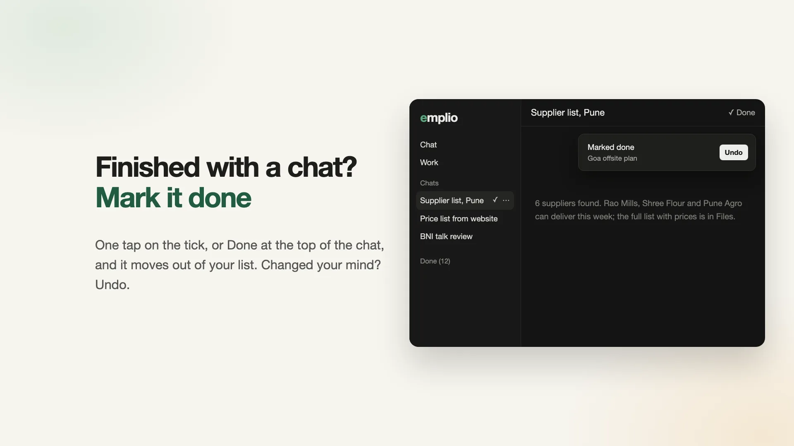
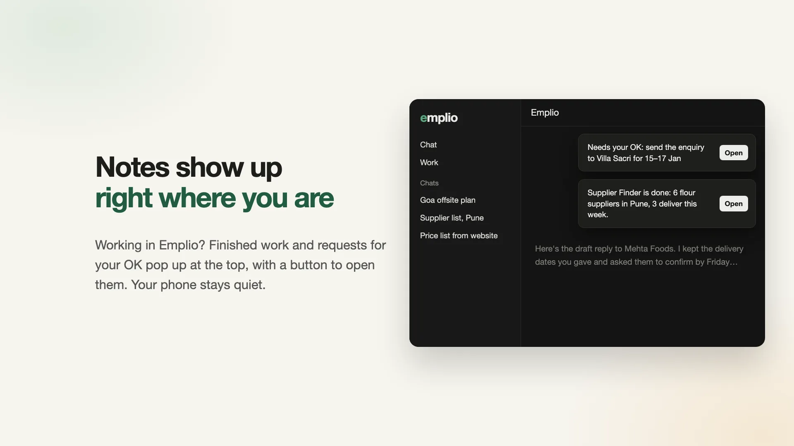
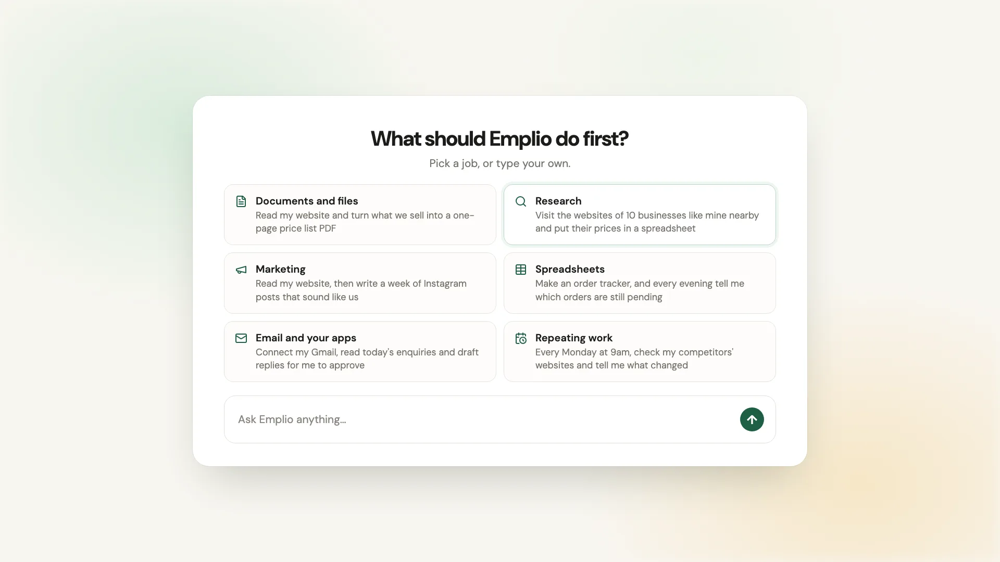
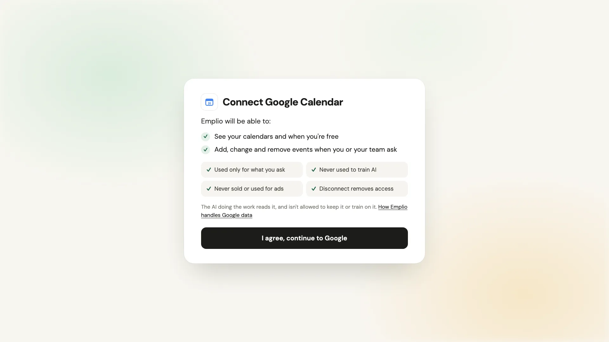
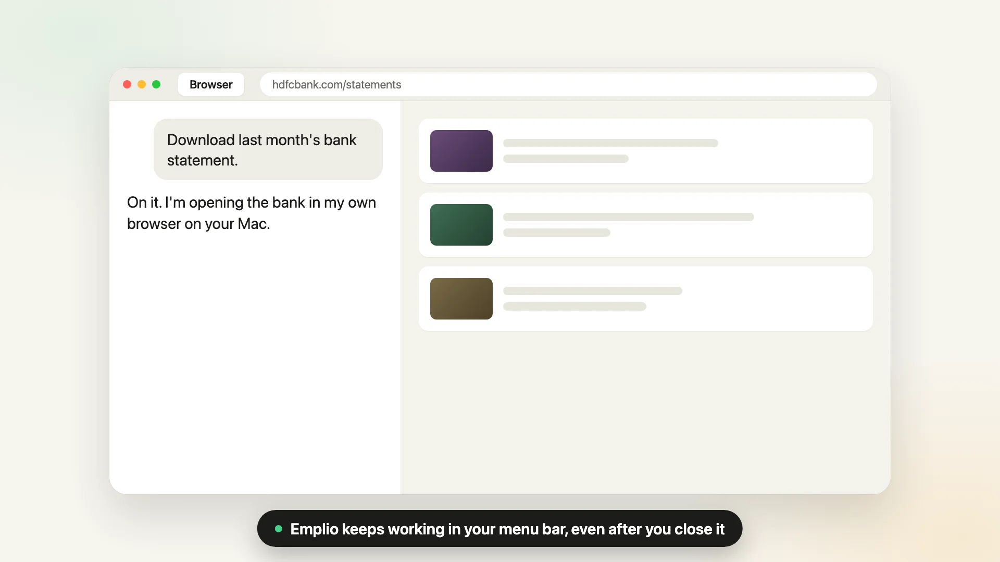
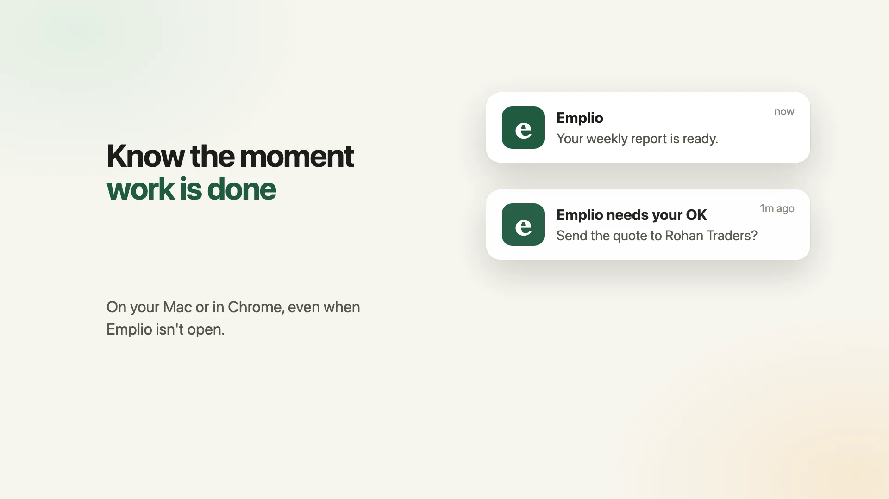
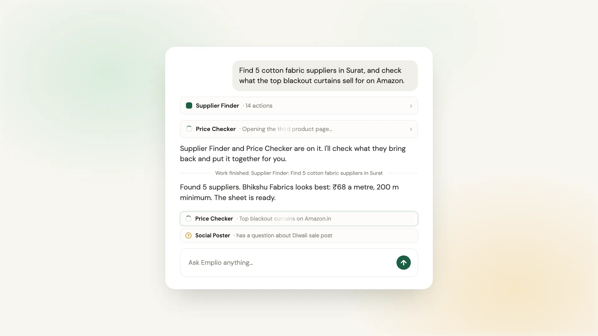
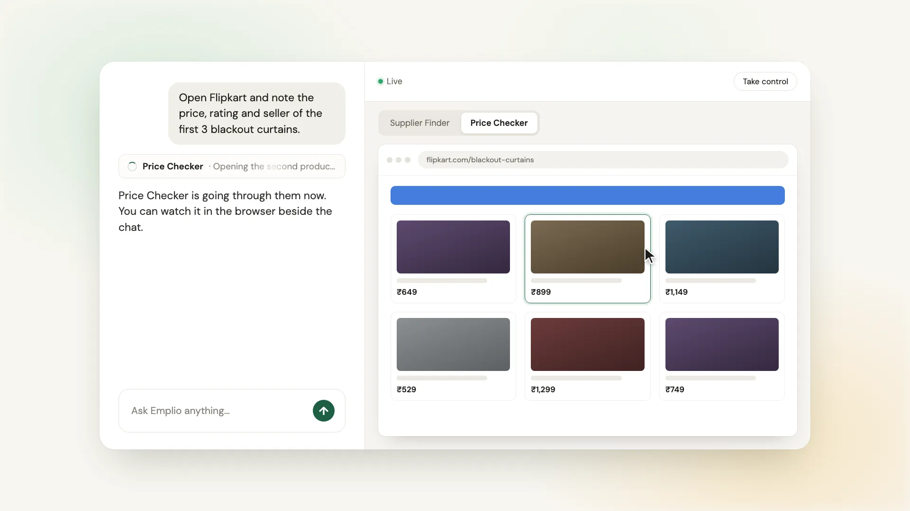
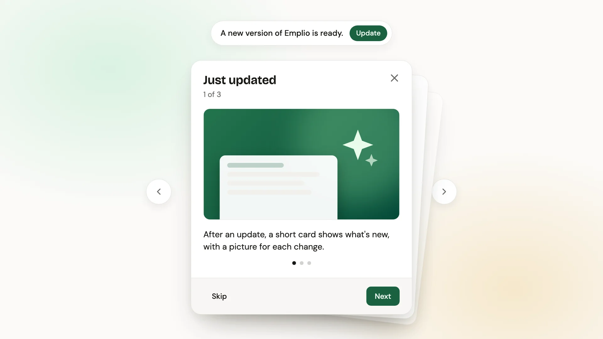

# Changelog

The newest version is at the top, and its heading is where Emplio's version number lives. "What's new" is shown to people in the app, so keep it in everyday words. See [CONTRIBUTING.md](CONTRIBUTING.md#releasing-a-new-version).

## 1.2.28 (2026-11-13)

### What's new

- When usage runs out partway through a piece of work, Emplio now stops right away and sends one last message saying what's done, what's left, and that it will carry on as soon as usage is added, instead of finishing the whole job first.
- The free trial for new businesses is now twice as big.

### For developers

- After each command, a paused business (`credit.pausedReason`) ends the run's commands via `failureGuard().end(outOfUsage(reason))`, so the next step must be the last message (#109).
- Free trial lot raised from $0.50 to $1 (`TRIAL.usd`, cloud #20).

## 1.2.27 (2026-11-13)

### What's new

- The Mac, Windows and Linux apps now update themselves: from version 0.2.0 on, a new version downloads in the background and is put in place the next time Emplio isn't busy, or when you choose Restart to update. If you have an older app, download 0.2.0 from the Downloads page once.
- Signing in with a popup ("Log in with Facebook", Google and the like) now works in the app's browser on your own computer.

### For developers

- Desktop apps 0.2.0 check `GET /desktop/update/:kind?version=` (hosted server): macOS uses Squirrel with a signed zip; Windows and Linux fetch the new folder beside the install, check its SHA-256 and swap it in after quitting (`desktop/src/update.js`, #110).
- The desktop browser lets Chromium create popups itself (`createWindow`), keeping `window.opener`; a page that closes itself closes its tab (#118).

## 1.2.26 (2026-11-13)

### What's new

- Emplio now runs on a fast, lower-cost AI by default. The Quality choices in Settings are renamed: **Free**, **Standard** (the new default), **Smarter** and **Best**. If you never picked one, you're now on Standard; choose **Smarter** in Settings, Agent, Quality to get the stronger AI for chats back.

### For developers

- Quality (`modelSet`) defaults to `save` (Claude Haiku for every role) instead of `default` (Sonnet chats). Stored values are unchanged; labels are now Free / Standard / Smarter / Best, and `emplio settings` lists each value with its label (#115).

## 1.2.25 (2026-11-13)

### What's new

- Older websites that reload the whole page when you press Save (many government portals, accounting and booking systems) are now faster for Emplio to work with: after saving one record on the page, it can save the next ones straight from the form instead of clicking through every field, keeping each page's own security codes.

### For developers

- `emplio browser calls` now records whole-page form posts (listed as `returns page`, status 302 when redirected); sign-in forms are never listed or saved. `send` to a form on the open page sends the whole form with the given fields replacing the visible ones, hidden fields always the page's own; only that form's exact address counts; file-upload forms are refused. Web pages in replies come back as their text (#112).
- README for engineers (#105).

## 1.2.24 (2026-11-13)

### What's new

- Emplio for Windows: download it from the Downloads page, unzip it and open Emplio. Like the Mac app, Emplio can then do its work on your own PC while it's on, fenced into its own Emplio folder: it can't see your passwords, browser data or personal folders.
- On a Mac, attaching files, opening saved files and using saved skills now work the same as on the cloud computer.
- Work moves cleanly between your own computer and the cloud one: Emplio knows which one it's on, and folders it copied in with their own history now come along.

### For developers

- Windows desktop app: commands run in Git for Windows' bash (fetched once, SHA-256 checked) at Low integrity (`desktop/src/fence-win.js`); the app reports `win32-getting-ready` until a fence test passes, and `deviceFor` gives work to `darwin` and `win32` (#108).
- The computer note moved from the cached instructions to each message's note (`computerNote`); a mid-reply switch is said in the command result (`computerChanged`).
- `EMPLIO_WORK` replaces `/work` written into the `emplio` script; request arguments are mapped back to `/work`; `stageScript` uses `wc -c` and sets nested `.git` folders aside as `.git.emplio`.
- The desktop apps fetch their own Python (python-build-standalone); kept scripts are Python.

## 1.2.23 (2026-11-13)

### What's new

- Finished with a chat? Tap the tick next to it in the list, or Done at the top of the chat, and it moves into a Done list at the bottom. A note with Undo lets you take it back, and anything new in the chat brings it back by itself. 
- While you're working in Emplio, finished work and requests for your OK now pop up inside the app, at the top right (along the top on a phone), with a button to open them. Your phone and computer stay quiet then; when you're away they still notify you as before. 

### For developers

- `push.ts` `route()` tries a new `app` sender first: `live.ts` `showInApp()` sends `{ type: "note" }` over `/events` to any open app that reported itself in front of the person (`{ looking: path }` on focus, blur, visibility and page changes), skipping the chat they're already on; when one takes it, the Mac, web push and phone senders are skipped (#107).
- Chats: "Archive" is now "Done" (a hover tick in the sidebar, a Done button in the chat header, "Not done" to undo); same `archivedAt` underneath. `useArchiveConversation` shows a "Marked done" toast with Undo.
- Toasts sit at the top right under the top bar (`components/ui/sonner.tsx`), along the top on phones.

## 1.2.22 (2026-11-13)

### What's new

- Emplio for Linux: download it from the Downloads page, unpack it and open `emplio`. It's Emplio in its own window, with its notifications on your desktop. For 64-bit PCs.

### For developers

- `desktop/build/linux/emplio` starts the app (`emplio-app`), adding `--no-sandbox` only where Ubuntu blocks Chromium's own sandbox and `chrome-sandbox` isn't set up as root.
- The Linux archive no longer carries macOS file attributes (`tar --no-xattrs --no-mac-metadata`).
- Tried on Ubuntu 24.04 (x64): opens to the sign-in page.

## 1.2.21 (2026-11-13)

### What's new

- The Mac app now runs on Intel Macs as well as Apple silicon, from macOS 11 (Big Sur). Macs on macOS 11 or 12 get their own download, linked under the main button.
- Talking to Emplio with your voice now works in the Mac app: it asks for the microphone the first time.
- The Mac app can ask to use your Documents and Downloads folders, as it already could for Desktop.

### For developers

- `desktop`: `npm run dmg` builds a universal app (Electron 45, macOS 13+); `npm run dmg:older` builds it on Electron 37.10.3 for macOS 11 and 12. Mac app 0.1.1 (#104).
- Entitlement `com.apple.security.device.audio-input`; microphone, Documents and Downloads prompts in `info.plist`.
- Chrome for Testing is fetched for the Mac's own chip, and only on macOS 12 or newer.
- `/download/mac-older` serves the older-Mac DMG; `DownloadButton` and `POST /downloads` know `mac-older`.

## 1.2.20 (2026-11-13)

### What's new

- Emplio can use the browser on your Mac again. Before this, jobs that needed a website stopped and said your Mac's browser wasn't reachable, even with the app open.

### For developers

- `devices.ts` `apiBase()` falls back to `WEBHOOK_URL` before localhost, so the link to the Mac's browser (`/device-cdp/...`) is the public address when the server sets only `WEBHOOK_URL` (#102).

## 1.2.19 (2026-11-13)

### What's new

- We now count who downloads the Emplio desktop app, and for which computer, so we know where to put our effort next.
- Groundwork for Emplio on Linux: the app can now be built for Linux. It isn't on the downloads page yet.

### For developers

- `DownloadButton` sends `app_downloaded` (platform, from) to PostHog and `POST /downloads` to the cloud, which keeps an `app_downloads` row with the signed-in user (#101).
- `/download/[platform]` passes through any desktop app the backend serves (`mac`, `linux`).
- `desktop`: `npm run linux` packs `out/Emplio-linux-x64.tar.gz`. Only a Mac gets Emplio's commands and browser (`deviceFor(userId, true)`); a Linux computer gets notifications only.

## 1.2.18 (2026-11-13)

### What's new

- A new chat on your phone now fits the screen: the starting jobs are a row of topics you swipe through, with three ideas under each, and everything sits centred.
- The ideas change through the day and from day to day, and "Show other ideas" gives you a fresh set.

### For developers

- `JobCards` in `first-run.tsx` is now category pills plus three jobs from a few per category, ordered by hour and rotated by day of year (#98).
- The empty chat centres with `my-auto` so tall content scrolls from the top.

## 1.2.17 (2026-11-13)

### What's new

- In the Mac app, the Back and Forward buttons now work and line up with the window buttons.

### For developers

- `DesktopHistory` renders after the sidebar so its no-drag area wins over the sidebar's window-drag row (#99).

## 1.2.16 (2026-11-13)

### What's new

- The Emplio Mac app now opens without any "damaged" warning: it is signed and checked by Apple.
- In the Mac app, Emplio's browser steps aside while a window such as Settings is open, so nothing is hidden behind it.
- The Mac app has Back and Forward buttons next to the window's red, yellow and green buttons.

### For developers

- `npm run dmg` in `desktop/` signs with the Developer ID, turns on the hardened runtime, notarizes and staples the app and the DMG (`build/sign-notarize.sh`, `build/entitlements.plist`); credentials come from the `emplio-notary` keychain profile (#88).
- The browser panel tells the app to hide the pane while a dialog or alert dialog is open (#95).
- Back and forward buttons beside the traffic lights in the Mac app, from the Navigation API (`components/desktop-history.tsx`).

## 1.2.15 (2026-11-13)

### What's new

- Everything in Emplio now moves a little more smoothly: buttons, menus and switches ease between colours, and bars fill gently.
- A window that opens on top of another window now dims the one behind it too.

### For developers

- Global soft transitions in `globals.css` (zero-specificity `:where`, colour/opacity/shadow only, off under reduced motion), `interpolate-size`, animated `
`.
- Dialog and alert-dialog backdrops use `forceRender` so nested dialogs dim what is behind them.

## 1.2.14 (2026-11-13)

### What's new

- A new chat now offers real jobs to start with, like checking competitors' websites, drafting replies to enquiries, or a price list made from your website. Tap one and Emplio starts. 
- Before you connect Google Calendar, Docs, Sheets, Meet or Analytics, Emplio shows what it will do and how your data is used. Your Google data is never used to train AI, and disconnecting also removes Emplio's access in your Google account. 
- Emplio now only uses AI services that don't keep or learn from your data.
- Google Calendar asks for less: Emplio can see your calendars and manage events, but can't create, delete or share whole calendars.
- Ask Emplio to change a setting or rename your business in the chat. It always asks for your OK first.
- Settings has new Business and You tabs for your business name and your own name, email, phone and Telegram.
- New businesses get a free trial to try Emplio with.

### For developers

- First-run flow (#85, cloud #14): free trial lot per person (ref = sha256 of the normalised email), Haiku lock while on it, console kill switch and `FREE_TRIALS_PER_DAY` cap; welcome dialog, job cards, Telegram offer after the second message; plans dialog in the app.
- Google sign-in at `/auth/google` (needs `GOOGLE_SIGN_IN=1` plus keys; off on live until Google verifies the app); its callback falls back to `WEBHOOK_URL` when `PUBLIC_API_URL` isn't set (#89); `safeNext` keeps sign-in redirects on this app's own pages.
- `emplio settings` (list, `set <setting> <value>`, `set name`, `set my-name`): every change waits for an Allow card with no "Always allow"; API keys refused.
- Google verification: Calendar scopes are `calendar.events` + `calendar.readonly`, admin actions (`acl_*`, `calendars_*`, calendar list writes) dropped; `GET /connect/:app` shows a disclosure page for Google apps until `agreed=1`; disconnect revokes the token at Google (`oauth.revoke`); every OpenRouter call sends `provider.data_collection: "deny"`. Privacy policy has a "Google user data" section (`/privacy#google`).

## 1.2.13 (2026-11-13)

### What's new

- Emplio now has a Mac app. It gives Emplio a browser of its own on your Mac, runs its work right on your computer for faster replies, and keeps going from the menu bar after you close the window. Get it from the Downloads page on emplio.app. 
- Get a notification the moment work is done or Emplio needs your OK, on your Mac or in Chrome, even when Emplio isn't open. Turn it on when Emplio asks. 
- The browser you watch on the web now looks the same as on the Mac: tabs, an address bar, and the full height of the page.

### For developers

- Desktop app (`desktop/`, Electron): the agent's browser is an embedded Chromium pane reached over the device link, with Chrome for Testing as a backup, sign-in save and restore, commands run on the Mac when it is online, an offline page, and a menu-bar background mode with a hidden host window (#86).
- Web Live view (`backend/src/browser-host.ts`) draws tabs and an address bar and fits the page to the panel height over CDP (#86).
- Mac app and Chrome notifications: `web_push_devices` table, `backend/src/webpush.ts`, a service worker, and `VAPID_PUBLIC_KEY`, `VAPID_PRIVATE_KEY`, `VAPID_SUBJECT` in the server settings; `backend/scripts/vapid-keys.ts` makes a pair (#86).
- `/download/mac` passes the Mac app through from storage so the browser stays on the site; the `/downloads` pages and the storage route live in the cloud folder (#86).

## 1.2.12 (2026-11-12)

### What's new

- Emplio now runs a team: it hands each piece of work to the right agent, checks what comes back, and stays free to talk with you while they work. Ask for more and the same agent carries on. 
- Watch your agents work: each agent's browser shows beside the main chat, a tab each. 
- Above the message box, a short list shows which agents are still working or have a question, however far up you asked. Tap one to open it.
- When work finishes, the line in the chat says which agent finished what.

### For developers

- Manager mode (#74): Emplio's main chat plans, hands off, checks and relays; agents do the work. `emplio hand <agent>` carries on that agent's latest job in the chat, `--new` starts a fresh one (refused while it's working or asking). No top-level `myself`; Emplio's own chats can't use the browser; soft command reminders only. Emplio does work itself only when the chat, its notes and its jobs' reports cover it in two commands or fewer, and writes final collated reports itself as one markdown file.
- `[SILENT]` replies (after sending work back, answering a job, or while a related job is still running) mark nothing unread and send no push.
- `GET /conversations/:id/working` lists a chat's top-level jobs that are working or asking (`WorkingJob`), with `browser` when its live view is up; it feeds the strip and the browser panel's tabs. A finished job that carries on takes the new brief's first line as its name and chat title.
- New evals: `evals/manager` (32 single decisions) and `evals/workday` (whole conversations on a fake computer); `bun evals/workday/report.ts old.jsonl new.jsonl` compares runs. Right call 72% → 94–98%; workday steps right 71% → 93%.

## 1.2.11 (2026-11-12)

### What's new

- When Emplio asks for your OK, the card names the action in plain words, like "Create a pull request".
- The Reply button on text you select stays with it while you scroll, and slides over when you select more or something else.

### For developers

- Own-provider actions get a `title` from their name (`actionTitle`, shared); cards saved with the code name show it too (#82).
- Quote button follows the selection on scroll (page-wide captured listener, once a frame), hides only while it's out of the chat's view, and fades in place so the next selection glides; no glide while scrolling (#83).

## 1.2.10 (2026-11-12)

### What's new

- After an update, a short card shows what's new, with a picture for each change. Swipe or tap Next to go through it, or Skip to close it. 

### For developers

- A "What's new" line can end with a picture or GIF, ``. `GET /changelog` now returns `changes` as `{ text, image? }`, and each device shows one slide per new pictured line after an update. GitHub release notes link pictures to the raw file.

## 1.2.9 (2026-11-12)

### What's new

- The card where Emplio asks for your OK is shorter: it never covers more than half the screen, the short details come first, and long text like an email shows a few lines with "Show all".
- The card's edges and shadow no longer look cut off in light mode.

### For developers

- Approval card: short fields first, long values (over 4 lines or 240 characters) clamp to 4 lines with Show all / Show less, also in the answered card; holder capped at `min(28rem, 50dvh)` and no longer scrolls, so it doesn't clip the card's ring and shadow (#79).

## 1.2.8 (2026-11-12)

### What's new

- When Emplio asks for your OK on something long, like an email or a pull request, the Allow and Deny buttons now always stay on screen. The details scroll above them.
- In spreadsheets, double-click the edge of a column heading to make the column fit its longest text, like in Excel.

### For developers

- Waiting approval card: header and buttons don't shrink, the fields scroll between them; the per-field height cap is dropped there so there's one scroll area (#75).
- Sheet viewer: double-clicking a column's resize handle fits it to its longest shown value, capped at 1000px; rows keep double-click to reset (#77).

## 1.2.7 (2026-11-12)

### What's new

- Long work no longer stops halfway and says it's done. When a helper runs out of steps it keeps going on its own, for up to 2 hours, and if it still can't finish it says so plainly.
- Helpers working through big documents save what they find as they go, so nothing has to be read twice, and they build the file you asked for step by step.

### For developers

- Jobs carry on in a fresh run after the step limit until `JOB_MINUTES` (now 120) is up; a run cut off by the step limit or by time reports "not finished" with status `failed`, not `done`. Default `maxSteps` 60 → 100. A timed-out run (`aborted`) no longer counts as completed. Job rules: extract big documents into a small file once and build the result as you go (#72).

## 1.2.6 (2026-11-11)

### What's new

- Buying a plan after the free period now starts the month's usage at 0%. Any free usage you had left is kept as extra usage.

### For developers

- Emplio Cloud billing: a first plan payment moves leftover founding, pass or free credit into extra usage, so it no longer counts in the month's percentage; a cloud migration fixes businesses already on a plan.

## 1.2.5 (2026-11-11)

### What's new

- When a new version is ready, the button now says "Update".
- The install guide shows how to check the install script before running it.

### For developers

- New-version bar button reads "Update" instead of "Refresh"; it still reloads the page (#69).
- README: the install checksum check is a visible section with a direct link to `install.sh.sha256` (#68).

## 1.2.4 (2026-11-11)

### What's new

- Emplio works better on a phone. Nothing hides under the clock or the home bar any more, the file viewer and live browser have a Back button, sheets don't throw the keyboard over themselves, and the menu now opens from a button at the top left of every page.
- Download and Export to Excel now work in the iPhone app: they open the share sheet, so you can Save to Files, AirDrop or Mail.
- Closing the keyboard no longer jumps the chat to the end.
- The iPhone app now shows your usage.
- DeepSeek models can be picked in Settings.
- Before installing a skill from the store, Emplio can read it first and install only one that fits.

### For developers

- Phone layout: one `--safe-top`/`--safe-bottom` pair for safe areas, top-left menu button (`SidebarTrigger`) on phones, bottom bar down to four tabs, sheet and dialog fixes; downloads in the app go through `saveFile` and the share sheet; chat keeps its distance from the end across resizes (#61).
- DeepSeek added to `MODEL_PROVIDERS` (#54).
- `emplio skills show <owner/repo/skill>`: read a store skill without installing it (#55).

## 1.2.3 (2026-11-11)

### What's new

- Searching your chats now shows chats whose name matches first, so typing "posthog" finds the chat called "Install PostHog MCP" at the top.
- New apps Emplio can work in: Google Business Profile (your listing on Google, with reviews first: read them, see the average, reply), Google Search Console, Google Analytics and Bing Webmaster Tools.
- Swipe can now start automations: a new invoice, a payment, an overdue invoice, low stock and more.

### For developers

- `/search` lists title matches first, then message matches from other chats; `emplio history search` is unchanged (#59).
- Google Business Profile as an own integration, 98 actions and 5 polled triggers; needs Google's Business Profile API access approved before it works (#58).
- Google Search Console (13 actions, 8 triggers) and Google Analytics 4 (190 actions, 9 triggers) on the shared Google sign-in (#60).
- Bing Webmaster Tools, all 62 methods as actions plus 4 polled triggers, connected with a pasted API key (#62).
- Swipe triggers: 7 from Swipe's webhook (set up with `get_webhook_setup`) and 8 polled (#57).

## 1.2.2 (2026-11-11)

### What's new

- Emplio can now upload files on sites that hide the spot to drop a file, like a Reddit community icon or a YouTube profile picture. It clicks the site's Upload button and hands over the file.

### For developers

- `emplio browser upload` takes a file box or the button that opens one; for a button it clicks it with the page set to give any file box it opens the files. The agent's browser guide now lists the command (#63).

## 1.2.1 (2026-11-11)

### What's new

- The card under a reply now only shows when one tap can answer it, and waits until Emplio's agents have finished. No more buttons like "Send the repo" that can't actually answer.
- Emplio is better at saving a skill when it learns how to do something, and suggests making an agent when the same kind of work keeps coming back.
- When Emplio closes its browser, it really closes, so a phone-size page it set up for a test doesn't stick around.

### For developers

- The next-step card writer moved to `backend/src/next-step.ts`; evals live in `backend/evals/` (run with `bun run eval evals`, results to Braintrust) with a repo skill on adding one. New dev dependencies: `braintrust`, `@braintrust/bt` (#23).
- `emplio browser close` stops the chat's browser after the command, saving sign-ins first (#50).
- Docs: Google Search Console ownership tag (#45).

## 1.2.0 (2026-11-11)

### What's new

- On phones, Emplio feels more like a phone's own app: sheets follow your finger and close with a quick flick, the bottom bar is frosted glass with your lists scrolling under it, and buttons give a little when pressed.
- If your phone is set to reduce motion, things now fade instead of sliding or zooming everywhere in the app.
- "Allow" requests now wait just above the chat box, so they stay in view however much is written after them. Once answered, each shows in one line whether it was allowed and how it went.
- Emplio no longer asks you to tap Allow after you already have.
- The next-step card no longer makes the chat jump, and editing a tapped answer shows just your answer.
- On phones, the buttons under a sent message no longer sit on top of the reply.
- When Emplio reports a problem, the step it took now shows in its list of actions.
- Emplio can test a website at phone size: its browser keeps the page size it was asked for.

### For developers

- Approvals have their own `approvals` table and `GET /conversations/:id/approvals`; cards are no longer part of a command's result, so the model never reads them. Cards left waiting by a restart are closed at the next start (#41).
- `emplio browser set viewport` is replayed before each later browser command for that chat's browser, and a hosted browser that won't change size is restarted at the asked size; `emplio browser viewport W H` is a short form (#44, #47).
- A browser being stopped is no longer picked up again (#42).
- `emplio report` shows in a reply's actions (#39).
- The phone app adds `@capacitor/haptics`; taps need the next iPhone build (#46).
- `/site/...` hands over to Emplio Cloud's pages, not found without the cloud folder (#43). Commits made as "Emplio" are exempt from the CLA check (#31).
- Database migration: `approvals`.

## 1.1.0 (2026-11-09)

### What's new

- After a reply, a small card sums up where things stand and asks what to do next. Tap an answer, or press Cmd+Enter (Ctrl+Enter on Windows) for the first one. Close it if you don't need it.
- Stripe, Asana, ClickUp, Airtable, HubSpot and Calendly now connect with a key you paste in.
- Emplio's browser costs less to run: it starts on a regular connection and moves to a local one only when a site needs it.

### For developers

- The next-step card replaces the greyed-out message guess: `GET` and `DELETE /conversations/:id/next-step` replace `GET /conversations/:id/suggestion`.
- Eight apps moved off Composio, with a shared webhook route and OAuth refresh tokens. Notion and Todoist stay on Composio on Emplio Cloud for now (#16).
- Sign-in integrations for Slack, Zoom, Google Calendar, Docs, Sheets, Meet and Zoho. Set `KEEP_ON_COMPOSIO` to keep an app on Composio, and `OWN_APP_TESTERS` to try ours on chosen workspaces (#19).
- Browsers start with no proxy and switch when a site blocks them or needs a sign-in; `emplio browser local` asks for it directly (#17).
- iPhone notifications go straight through Apple, off unless `APNS_KEY_ID`, `APNS_TEAM_ID` and `APNS_KEY` are set (#20).
- Database migrations: connection refresh tokens, paid sites, and push devices.

## 1.0.0 (2026-11-09)

### What's new

- See what's changed any time, from What's new in your account menu.
- Emplio tells you when a new version is ready, and one tap brings your screen up to date.
- Replies are shorter: a line or two, unless you ask for more.

### For developers

- `CHANGELOG.md` is the one place versions live. `GET /health` reports the running version and `GET /changelog` the "What's new" lines.
- The app compares the version it first saw with the server's on reconnect, on focus and every 5 minutes, and offers a reload when they differ.
- Each new version on `main` publishes a GitHub release and version-tagged Docker images.
- Tightened the default reply length in the system prompt (#2).
